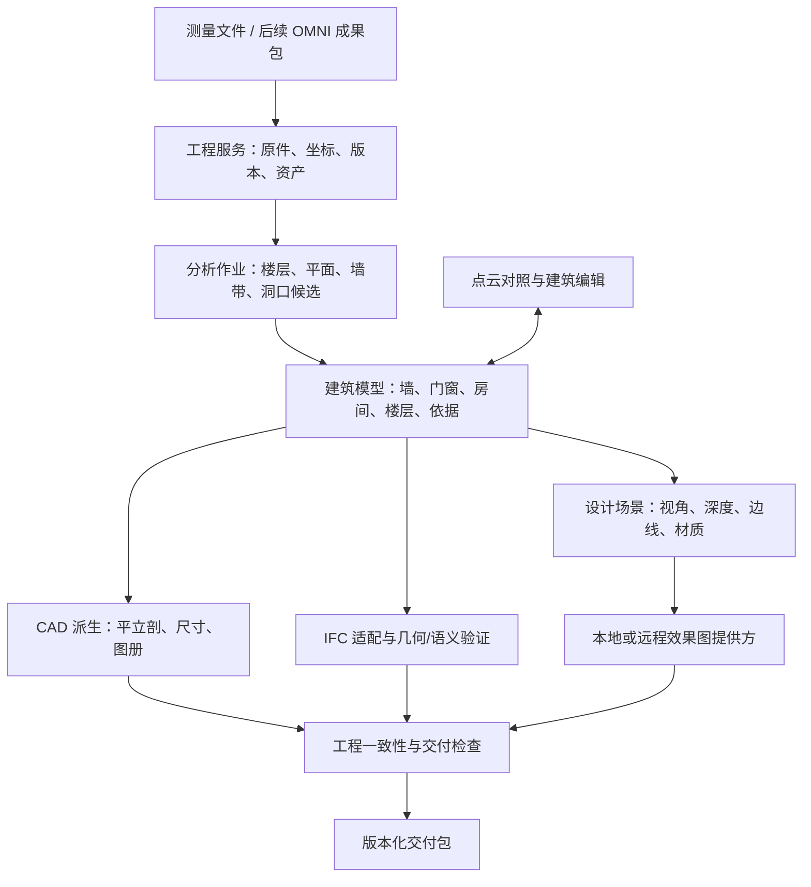
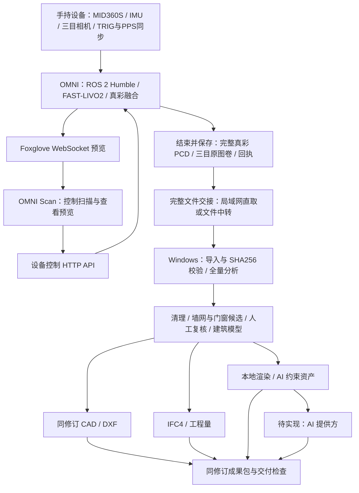

# Windows 空间数据工作室：从测量成果到工程交付

状态：当前开发与打包版本 0.10.1，以建筑测绘、点云编辑和 CAD 交付为主线；BIM/AI/关键帧均为扩展。已实现原生尺寸、全量剖切、按纸面尺寸出图、矢量图纸/PDF和等比例纸空间视口。0.9.3 的 Windows/设备历史记录不转为本版验收；真实尺寸、完整测绘几何、接收工具与现场放行仍未完成。本文中的目标/后续不能作为已实现功能说明。

完整产品链为 **OMNI 手持扫描 → 保存完整真彩点云 → 文件交接 → Windows 离线处理 → CAD/BIM/设计表达二次交付**。端到端技术栈、接口和落地验收见[第13节](#13-omni-手持扫描到二次交付的端到端技术栈)。

## 2026-10-29 当前产品合同：点云编辑与专业 CAD

本节覆盖下文历史版本的实施优先级。用户已明确首批用途为**建筑测绘**；成果优先为实测现状平面、立面、剖面、尺寸与测量复核，不从点云推定结构设计或施工做法。主线为完整点云 → 单位/坐标核对 → 清理及高度剖切 → 平立面绘图 → 几何尺寸与专业标注 → CAD 复核交付。建筑模型、AI、效果图、关键帧比对属于可选扩展，不作为点云导入、出图、保存或 CAD 交付的前置条件，不在打开原图工程时抢占主工作区。

验收条目：

1. 一级导航突出点云/CAD与图纸交付；扩展功能收进独立入口；保留已有工程兼容。
2. 框选与高度剖切均作用于完整源点，可撤销、恢复并随工程保存；原件不改写。
3. 几何毫米值、显示取整与真实精度分别记录。新尺寸保存定义点与方向，DXF 输出原生 DIMENSION、样式及匿名显示块；预览与导出取自同一记录。
4. 交互尺寸支持水平、垂直、对齐，以及端点捕捉、查看原始长度、删除/撤销；更新几何时不得把旧尺寸悄悄贴到新图。
5. CAD 包独立于 BIM，包含图纸、标注/尺寸定义、原件哈希、清理规则、参数与复核项；存在疑点时明确为复核用途。
6. 用已知毫米几何、旋转/非整毫米尺寸、工程往返、独立 DXF 读取与界面实际操作验证。真实施工放行还需要独立实测和目标 CAD 软件检查，解析成功不能代替尺寸及现场验收。

实施顺序：A 主工作流与全量高度剖切；B 原生尺寸及人工捕捉标注；C CAD 交付核验、图框/图册与目标工具验收。PDF/打印比例及复杂墙网按此顺序继续，不以 BIM 或 AI 新能力替代 CAD 工作。

当前实现和验证记录以实际源码、测试及 `artifacts/cad-core-20261029/` 为准，以上为目标合同。

## 1. 产品中心定位

**面向测量与既有建筑改造的专业点云编辑和 CAD 出图工具；建筑模型、AI 与关键帧为可选扩展。**

主价值按优先级排序：

1. 产出建筑测绘现状图，减少点云描图、重复标注与整理成果的工作。
2. 优先保证点云清理/剖切、平立剖几何和尺寸标注可编辑、可核对。
3. 区分实测点、拟合几何、人工补绘和缺测范围，保留坐标/单位/版本及尺寸核验。
4. BIM、AI、效果图和关键帧作为扩展，不影响独立测绘出图与交付。

本轮以用户截图中的室内既有建筑为初始适用场景。多楼层、斜墙、外立面和大空间由同一模型扩展；当前算法不据此承诺覆盖这些场景。产品不再以物体提取、收藏、自由曲面或 GLB 创作作为主流程。

截图用于明确交互和交付方向：点云/模型并排、建筑构件编辑、自动出图、可编辑 CAD/BIM、工程交付与效果图。截图与宣传字幕不能证明竞品识别算法、精度、输出格式或自动化成功率。

## 2. 成果与一级工作流

| 工作区 | 用户动作 | 目标成果 | 首要质量要求 |
| --- | --- | --- | --- |
| 测量成果 | 导入、单位/坐标核对、楼层划分、剖切和完整性检查 | 可追溯测量工程 | 原始数据和坐标变换可恢复 |
| 建筑理解 | 自动提取、查看疑点、局部修正 | 参数化建筑模型 | 内外墙、门窗宿主、房间闭合正确 |
| 工程图 | 平/立/剖面、尺寸/房间/构件标注、图框与图册 | DXF、PDF，后续 DWG 适配 | 同一建筑修订派生，尺寸可核对 |
| BIM | 轴线、厚高、门窗、房间、楼层编辑，属性与工程量检查 | IFC4 + 构件/工程量表 | 有建筑语义、实体几何和有效关系 |
| 建筑效果图 | 选视角、设置风格、生成和比选 | 效果图及其模型/视角版本 | 空间约束可追溯，设计表达单独保存 |
| 成果交付 | 选择交付项、查看待解决问题、生成成果包 | 图纸、IFC、清单、报告与效果图 | 修订一致、文件可打开、单位/比例正确 |

“一键”定义为启动有明确输入和可取消进度的一条作业：自动分析 → 构件化 → 检查 → 派生成果。证据充分的部分自动完成；仅把缺测、冲突或不确定构件集中给用户修正，不要求逐一重复确认所有构件。

## 3. 当前源码事实与复用边界

| 现有模块 | 能复用的内容 | 不能直接推导的能力 |
| --- | --- | --- |
| `../../src/domain/pcd.ts`, `ply.ts`, `las.ts` | PCD/PLY/LAS/LAZ 解码 | 厘米精度、配准正确、大工程分块能力 |
| `../../src/cad/geometry.ts:buildCadWallEvidenceMap` | 跨高度墙带证据、投影、方向对齐 | 完整建筑语义识别 |
| `../../src/cad/geometry.ts:fitOrthogonalWallPlan` | 外围四边的正交墙段拟合 | 内部隔墙网络、多房间、斜墙、门窗识别 |
| `../../src/cad/model.ts:buildDrawingModel` | 毫米制图元、图层、图框、尺寸和来源说明 | 参数化墙体/BIM、可靠房间净面积 |
| `../../src/cad/model.ts:applyCadAnnotations` | 标注身份、位置、图层和来源 | 门窗宿主、洞口切割或可编辑门窗族 |
| `../../src/cad/dxf.ts:exportCadDxf` | 毫米几何、原生 DIMENSION、样式和显示块、纸空间视口 | 与被标注几何的自动关联、原生 DWG 适配仍未实现 |
| `../../src/cad/package.ts:createCadDelivery` | DXF/标注/校验清单 | IFC 或完整施工图审查 |
| `../../src/components/CadPreview.tsx` | 图层、视图、图元查看、标注交互 | 建筑构件编辑器 |

旧 Windows 应用在本次会话中已取得硬件渲染、Open3D 物体重建等证据，但 CAD 当时仅验收入口。旧应用结果不能转移为本目录新应用的 Windows 验收结果。

本轮已进一步验证现有出图算法的精度边界：8×6 m 合成房间输出墙体范围 8000×6139.535 mm，纵向偏差 +139.535 mm，格网分辨率 186.047 mm。`scripts/measure-baseline.ts` 可重现；该结果证明当前算法只能作为流程和复核基座，必须在 S1/S2 引入建筑几何拟合后重新验收工程精度。

## 4. 总体架构



目标层次与实现边界：

- **桌面层**：Electron + React + TypeScript；点云/建筑三维采用 Three.js，二维工程图采用独立 CAD 视图。界面按工程任务组织。
- **应用层**：工程打开/保存、作业调度、命令历史、派生物失效、批量生成、交付准备。当前已有 CAD、建筑候选与编辑、IFC 和本地渲染；跨工作区的一键编排与统一交付包待补齐。
- **领域层**：建筑模型是 CAD、BIM、工程量的共同源；编辑记录作为命令提交，引用稳定构件编号。
- **计算层**：当前全量解码、墙线/建筑候选、墙面立面与 IFC 检查使用 Web Worker，IFC 检查采用 web-ifc WASM。后续重型识别确有需要时再引入独立本地计算进程，任务采用版本化 JSON + 文件资产。
- **适配层**：CAD（DXF/PDF/DWG）、BIM（IFC/RVT 桥接）、效果图提供方分别适配，不把第三方格式结构渗透到建筑模型。
- **存储层**：初期可移交工程包；大项目阶段使用工程目录 + SQLite 元数据 + 分块资产。迁移时保留 `.pvplan` 导入器与源文件校验。

## 5. 建筑模型与坐标契约

最小共享对象在 `src/domain/building.ts` 定义：

| 对象 | 必须具备的信息 |
| --- | --- |
| 工程/源资产 | id、源文件 SHA256、原始单位/坐标系、采集批次、原件位置、变换、注册误差来源 |
| 楼层 | id、名称、标高、上下边界与来源 |
| 墙 | id、楼层、中心轴/曲线、高度、厚度、与其他墙连接、实测依据 |
| 门窗/洞口 | id、类型、宿主墙 id、沿墙位置、宽高、窗台/门槛、朝向/开启属性与依据 |
| 房间/空间 | id、楼层、闭合内边界、名称、净面积/体积计算方法与依据 |
| 图纸 | 建筑修订、视图定义、比例/图幅、关联构件、标注和人工修订 |
| 效果图 | 建筑修订、相机、深度/边线资产、风格、提供方版本、结果引用 |

约束：

1. 领域长度单位统一为米，Z 向上；工程坐标和局部渲染原点分开。大地坐标在双精度域处理，减去局部原点后才进入 GPU Float32。
2. CAD 模型空间在适配边界转为毫米；比例仅影响排版，不能再次缩放测量几何。
3. 后续必须存储 `T_project_source` 和所用楼层/建筑方向变换；模型、投影和源点查询共享变换。
4. 每个构件记录来源：实测/推断/人工、源资产、源修订、证据位置或平面内点；自动拟合分数不冒充测量置信区间。
5. 人工编辑建立新建筑修订；基于旧修订的 CAD/IFC/效果图变为过期。异步旧任务不能覆盖新编辑。
6. 房间面积由有效内边界计算；外包络、点云凸包或体素占用面积不能用作房间净面积。
7. 墙体厚度、门窗和背面在单侧缺测时保留不确定性；不因常见户型而伪造实测值。

当前语义校验已实现编号、楼层引用、墙体几何、门窗宿主/尺寸与洞口重叠、房间基本边界/自交及复核标志。完整墙网/房间邻接、通用几何内核和完整 IFC schema 检查仍待完善；基础校验通过不等于工程交付验收通过。

## 6. 自动建筑理解的实施路线

```text
源点云与姿态/照片
→ 坐标、单位、重力方向和质量检查
→ 按楼层/高度带建立占据、密度与法向证据
→ 地面/顶面与竖直平面提取，建立墙平面候选
→ 墙面配对、轴线/厚度/高度、相交与连接求解
→ 门窗候选：沿墙高度占据、边界与可选图像语义共同判断
→ 房间拓扑闭合与洞口邻接
→ 局部不确定项修正
→ 建筑模型检查与 CAD/IFC 派生
```

初期用几何方法建立可解释基线，再接入学习模型改善类别和遮挡情况。不能只靠语言模型描述截图来生成尺寸，也不能把墙面扫描缺口统一判成门窗。几何识别作为本地引擎工作；照片语义输入与几何需有已验证的位姿/标定关系。

## 7. CAD 与 BIM 交付

CAD 分两条派生路径：现有墙带图元支撑当前基座；建筑识别稳定后由建筑模型统一派生墙线、洞口、门窗符号、房间名/面积、尺寸链、立面与剖面。用户标注附着构件或视图锚点，构件移动后可重算。

DXF 首期沿用公开交换格式，后续补关联 DIMENSION、图块和图册布局；PDF 需验收真实页面尺寸、字体、线宽和打印比例。DWG/RVT 作为专用适配器评估授权和兼容性，不能通过改扩展名交付。

BIM 目标采用 **IFC4**：

- `IfcProject → IfcSite → IfcBuilding → IfcBuildingStorey` 空间层级；
- 墙体实体与可计算几何；门窗通过 `IfcOpeningElement`、`IfcRelVoidsElement` 和 `IfcRelFillsElement` 建立宿主关系；
- 房间采用 `IfcSpace`，支持空间边界与可核对工程量；
- 属性中保留源点云引用、原模型构件 id、修订、实测/推断状态和编辑来源；
- 导出后检查 IFC schema、几何形状、数量、单位、楼层标高和关系；使用目标工具做打开/尺寸/构件编辑兼容性验收。

建议后续通过 IfcOpenShell 本地进程处理 IFC。引入时固定 Windows/Python/IfcOpenShell 版本和许可证信息，随软件配送，避免用户手工配置环境。IfcOpenShell 目前未安装。0.4 已采用 TypeScript IFC4 输出和 web-ifc WASM 解析/几何检查，不依赖 Python。

## 8. 建筑效果图

效果图由工程模型派生设计场景，分为基础视图和 AI 表达：

1. 用户选楼层、房间/视角与设计风格；先由真实模型输出透视图、深度图、边线和对象遮罩。
2. 提供方适配器提交 `ArchitecturalRenderRequest`，带模型修订、视角和控制资产。
3. 本地生成和远程服务使用同一接口。远程提供方、上传范围、模型费用和凭据配置需要另行确定；本轮不调用付费服务或上传测量数据。
4. 生成结果保留视角与模型来源，作为设计表达保存；不反写尺寸、开洞或实测构件。
5. 几何保持能力必须以固定数据集对照测量模型检查，不能把视觉上逼真的效果图当作施工依据。

## 9. Windows 应用、依赖和工程规模

当前新入口 `electron/main.cjs` 只开放本应用窗口的文件打开/保存 IPC，采用 contextIsolation、sandbox，禁用任意新窗口和导航。新 appId、配置目录和交付目录独立。

后续计算进程的入口由主进程解析固定路径，参数通过作业清单传递，禁止将用户内容拼成 shell 命令。每项任务声明输入资产、源修订、输出目录、超时/取消协议和结果清单。线程数、内存和 GPU 预算进入引擎配置，不放在界面调试日志中。

大型测量成果下一阶段使用空间分块/LOD 与后台索引：显示采样、算法采样、原始测量证据分别记录；渲染刷新不触发重复识别。当前完整点集 Web Worker 分析为过渡基座，不声明为亿级点云方案。

打包目标 Windows x64 文件夹 ZIP + 当前用户 NSIS 安装器。计算运行库按实际引擎引入；不把旧物体重建 Open3D 环境复制进新基座。旧包已遇到 260 字符解压路径限制，正式发包须测短/长路径、中文目录、首次离线运行，按内容缩短冗余路径。

## 10. 实施切片与验收

| 切片 | 成果/范围 | 验收 | 停止条件/依赖 |
| --- | --- | --- | --- |
| S0 本轮基座 | 独立 Windows 工程，复用 CAD，源点云/工程包、图纸与标注、语义契约 | 构建；真实解析与成果包测试；浏览器工程往返 | 不引入付费服务，不自动替换旧 Windows 软件 |
| S1 建筑模型 | 楼层、墙、洞口、房间编辑；坐标与命令历史；局部修订 | 已知几何基准、变换往返、门窗宿主、闭合/自交/尺寸检查 | 先确定真实工程样本与质量要求 |
| S2 自动识别 | 多房间墙网、厚高、门窗候选、缺测复核 | 留出实测数据；墙偏差、厚高误差、门窗精确率/召回率、房间拓扑准确率 | 单场景失败不能靠外包络替代；依赖 S1 |
| S3 CAD/BIM 闭环 | 关联标注、平立剖、尺寸链、PDF、IFC4 | 同修订派生、IFC schema/几何/关系、目标 CAD/BIM 工具打开与编辑 | IFC/原生格式兼容性须实测；依赖 S1/S2 |
| S4 AI 效果图 | 模型视图约束、风格、生成/比选、来源 | 固定视角对照、空间结构变化统计、费用/取消/隐私边界 | 提供方与数据上传未确定时不接外部生产服务 |
| S5 Windows 发版 | 版本化安装器、完整依赖、真实工程回归 | 安装/卸载/升级、原生对话框、离线、GPU/驱动、路径、恢复、性能 | 新应用实测后才替换测试机入口 |

工程精度阈值必须由实际用途和数据质量确定。基准需有独立实测真值，记录墙面/轴线误差分布、厚度/高度误差、门窗定位尺寸误差、净面积误差和失败覆盖范围；配准误差与自动拟合误差分别统计。尚未确定的阈值不得宣传为厘米级保证。

## 11. 大数据适配切片（0.2.0）

以用户指定的 800,000,584 字节、20,000,000 点真实 binary PCD 为基准：

- Windows 只向渲染进程返回文件能力 token、字节数和 SHA256；`electron/source-store.cjs` 持有文件句柄，按最大 8 MiB 的范围读取，拒绝源件变化或越界访问。
- Worker 按 PCD 字段布局完整解码 2000 万点，完整坐标/RGB 留在 Worker；只传最多 120,000 点显示预览给界面。原始法向/置信度/观测次数等字段由磁盘原件完整保留，并非当前墙带算法的输入特征。
- 大点云 CAD 遍历完整坐标，将每点累计进 256×256×32 网格的计数/坐标矩；在非空单元质心上运行旧 CAD 内核。基准产生 15,386 个单元，所有 2000 万点参与累积。该方法是显式的几何聚合，不是逐原始点拟合。
- 分析模式、源点数、参与点数、聚合数量、网格尺寸和源件哈希写入 DXF 成果包新增 `analysis.json`。旧的配准/尺寸/建筑识别精度问题不会因文件变大而自动解决。
- 保留严格正交墙带模式。真实整场景 XY/YZ 严格模式证据不足时仍拒绝生成；用户可以明确选择“投影证据轮廓 · 复核用”，其轮廓可能包含非建筑物，不作为自动识别墙体。
- Windows `.pvplan` v2：`PVPLAN2\n` 魔数、4 字节小端清单长度、JSON 清单和完整源件原始字节。流式复制到同目录临时文件，复制时重新计算源件 SHA256，一致且未取消才原子替换目标；失败/取消不替换旧工程。
- 打开 v2 工程先验证源件字节范围和 SHA256，再按嵌入区间流式读取；不依赖原点云路径。兼容打开旧 v1 小工程。为避免覆盖当前原件/活动工程，当前需另存为新文件名。
- Worker 取消后保留已显示工程与源件引用；下一次分析自动重读完整源件。文件哈希/保存任务使用 AbortController，关闭应用时释放文件句柄。

容量边界：当前 Windows 单个源件上限 2 GiB，binary PCD 解码保护上限 5000 万点；实际验收容量为此 2000 万点原件。其他格式仍走最多 256 MiB 的兼容解码路径。浏览器可分块导入，但大工程流式保存/恢复由 Windows 桌面接口承担。

验收：确定性分块/RGB/单位/截断测试；流式工程哈希、损坏拒绝和取消保护；原有界面回归；真实原件在本地和 Windows 的点数、预览预算、三视图复核图、DXF/元数据、800 MB 工程保存恢复和取消后重建。实机记录以 `artifacts/windows-large-20261020/` 为准。

## 12. 本轮可验收范围与下一决策

本轮完成标准：新目录可以独立启动工程工作台，未加载旧创作流程；基于明确标识的合成测量样本可出图、标注、导出、保存恢复；单位不会二次缩放，过期图纸不能导出；建筑语义与后续引擎边界可以继续实现。

待后续选定：真实测量基准项目、首批建筑场景、精度/交付要求、接收 CAD/BIM 工具版本，以及 AI 本地或远程提供方。本轮先建立无需这些选择即可验证的本地架构，不把未确定选项固化为外部服务依赖。

参考标准与实现资料：

- [buildingSMART IFC4 墙体定义](https://standards.buildingsmart.org/IFC/RELEASE/IFC4/ADD2/HTML/schema/ifcsharedbldgelements/lexical/ifcwall.htm)
- [buildingSMART IFC4 门定义](https://standards.buildingsmart.org/IFC/RELEASE/IFC4/FINAL/HTML/schema/ifcsharedbldgelements/lexical/ifcdoor.htm)
- [IfcOpenShell 几何与放置接口](https://docs.ifcopenshell.org/ifcopenshell-python/geometry_creation.html)

这些资料支持目标语义和导出技术选型，不构成当前软件已符合 IFC 或目标 CAD/BIM 工具验收的证明。

## 13. OMNI 手持扫描到二次交付的端到端技术栈

更新日期：2026-10-27。依据本地当前源码核对；本次仅完善架构与实施合同，未新增扫描、部署、文件传输或整链实机验收。

### 13.1 产品链与职责

第一层交付是采集完成的测量原件 `tri_true_color_*.pcd`；第二层交付是经过桌面分析、复核与设计处理的工程成果。两层以同一份完整点云的 SHA256 关联。



Windows 只消费保存完成的文件，不订阅实时点云，不承担设备控制或建图。手机预览用于现场覆盖判断，显示抽样不进入桌面工程分析输入；手机也不是完整文件交接的必经节点。

### 13.2 技术栈与代码归属

以下路径相对 `/mnt/zk/point_view`；采集端路径另行标明。

| 层 | 当前技术与入口 | 能力及边界 |
| --- | --- | --- |
| 传感与同步 | MID360S、IMU、三目相机、STM32 TRIG/PPS；`/mnt/zk/3DGS/scripts/rk3588/production_fast_livo.sh` | 已有采集/同步/标定启动链；本次未核验现场硬件和运行状态 |
| 边缘计算 | Orange Pi/RK3588、ROS 2 Humble、FAST-LIVO2、进程内真彩融合 | 设备端负责连续建图与最终完整点云；精度/色彩质量独立验收 |
| 手机端 | React、TypeScript、Three.js、Worker；`src/handheld/` | 控制、累计预览、设备项目、完整文件缓存；Waydroid WebView 测试壳已有记录，`omni/` 中 Tauri 2 工程的正式手机包另行验收 |
| 控制/文件服务 | Python HTTP；`/mnt/zk/3DGS/scripts/rk3588/omni_app_control_server.py` | start/pcd/stop、状态与项目、预览/完整文件；预览走 Foxglove WebSocket |
| 文件交接 | 现有项目 HTTP 完整文件接口；已有 PCD-only SSH/文件同步链 | 桌面完整PCD及全部原图卷接收已实现，已校验文件复用；现接口不支持单文件内部Range续传 |
| Windows 外壳 | Electron、Node.js、React、TypeScript、Vite；`windows-studio/electron/` | 原生文件读写、分块读取、哈希与 `.pvplan` v2 流式工程 |
| 点云与几何 | Three.js、Web Worker；`windows-studio/src/pipeline/` | 全量 PCD 分块解码、清理重放、墙线、建筑候选、墙面颜色/深度；显示有独立预算 |
| CAD/BIM | 共享 `src/cad/`；`windows-studio/src/domain/building*.ts`、`ifc*.ts`；web-ifc WASM | 统一建筑模型、DXF、IFC4、工程量与离线解析；自动完整建筑识别和目标软件兼容验收待补齐 |
| AI 与表达 | `windows-studio/src/domain/contracts.ts`、`RenderWorkspace.tsx` | 已有本地AI评估识别、渲染及深度/边线/来源包；商用识别模型与生成式服务仍待 |
| 二次交付 | `windows-studio/src/domain/delivery.ts`、`src/App.tsx` | 同修订CAD/IFC/工程量/观察/文件哈希复核包已实现；渲染独立导出，PDF图册待实现 |

以现有栈串联，当前阶段无需增加消息中间件、微服务群或新的数据库。可选上云复用 `src/handheld/cloud/CloudUploadClient.ts` 与 `scripts/omni_cloud_server.py`；现参考服务只提供上传与回执，没有桌面下载/分享合同，不能将其视为已经打通的云端交接。

### 13.3 采集到桌面的数据合同

复用现有接口：

| 接口 | 用途 |
| --- | --- |
| `POST /api/v1/actions/start` | 手机发起采集 |
| `POST /api/v1/actions/pcd` | 对当前 `expectedSession` 结束并保存 |
| `POST /api/v1/actions/stop` | 停止当前会话；停止本身不代表保存完成 |
| `GET /api/v1/status` | 查询会话与作业结果，保留 succeeded/warning/failed 的区别 |
| `GET /api/v1/projects` | 读取已有导出回执对应的项目列表 |
| `GET /api/v1/projects/{session}/file` | 取得完整 PCD |
| `GET /api/v1/projects/{session}/preview` | 取得抽样预览，不作为完整源件 |

现有项目条目含 `id`（设备 session）、`fileName`、`bytes`、`points`、`sha256`、`createdAtMs`；保存结果另有 `backupVerified`。桌面接收应核对实际字节数、SHA256、PCD 头/载荷和完整点数后，才标记可导入。`backupVerified` 不证明 Windows 已取得文件，也不证明测量质量。

**当前保存的部署依赖**：`production_fast_livo.sh` 导出并校验设备文件后，还要求通过密钥 rsync 至默认 `jn@10.42.0.241`，再次校验一致才返回成功；备份失败会使整体保存作业失败，即使设备 PCD 与回执已经存在。完整产品链需先将“设备已保存、备份已完成、桌面已接收、质量检查结果”作为独立事实返回，允许离开电脑仍保存成功，并在之后重试传输。设备项目列表也需携带持久化的质量状态，避免保存告警在后续导入时丢失；不得仅将退出码改为0或把 `backupVerified` 固定设为true。

拟在桌面工程源资产中补充设备身份、采集 session、原文件名、导出/接收时间、单位、坐标定义及来源；缺少的单位/坐标信息由导入复核明确，不能仅凭 PCD 扩展名推断。继续使用既有源 SHA256 和建筑 `sourceStamp`/`revision` 表示原件、处理范围和模型版本，避免新增平行身份体系。采集时间与接收时间分别记录，文件 mtime 不冒充可信采集时间。

这些元数据从接口或导入复核生成并随桌面工程保存；设备到本机默认仍只同步 `tri_true_color_*.pcd`，不为串联额外同步 rosbag、数据库或整个会话目录。照片语义属于后续增强输入，当前 PCD 主链无需等待照片包。

下载先写临时文件，校验一致再原子提交；失败/取消保留已有工程，不能以半文件创建成功项目。该桌面下载流程是待实现项，不能据设备已有 GET 接口宣称完成。现设备 GET 接口未实现 Range，首版中断后须重新下载；断点续传需要服务端与客户端共同实现。

### 13.4 网络与容量边界

- 本轮已确认 Ubuntu 经 Wi-Fi 直达 OMNI `10.42.0.1`，经有线网络可 RDP 登录 Windows `192.168.3.125`。这两条连接不证明 Windows 能直达设备，RDP 也不是产品文件传输接口。
- 目标顺序：Windows 与设备可达时直接取得完整 PCD；否则沿用已有本机 PCD 文件中转与 Windows 本地导入。实现直取前从 Windows 测试设备 HTTP 可达性；本架构不隐含开启 Ubuntu 路由转发或改动防火墙。
- 手机项目 Worker 与参考云服务当前均有 **512 MiB** 限制；主要桌面真实样本为 **800,000,584 字节/2000万点**，不能经过现手机解析/参考云上传链完成交接。大文件主链先直接送桌面，手机只保留项目元数据和预览；不得通过降低原始点数绕过上限。
- Windows 当前单源件上限 **2 GiB**，binary PCD 解码保护上限 **5000万点**，实际历史验收为 **2000万点**；其他格式仍为 **256 MiB** 兼容路径。超过范围时明确拒绝，后续再按真实需求建设空间分块/外存算法。
- 桌面显示最多12万点与 Worker 完整源点分析各自计数。不能以画面点数、手机累计预览或聚合单元数替代最终 PCD 点数。

### 13.5 桌面处理、一键作业与 AI

主流程：完整源件 → 单位/坐标复核 → 清理/剖切 → CAD 几何与标注 → 图纸复核交付。BIM、AI 与关键帧通过扩展入口按需进入。沿用 `EngineJob` 的 sourceRevision 和现有取消/过期机制，统一编排仍需实现；已有独立按钮不等于“一键出完整工程”。

AI 分两类接入：学习式建筑识别补充现有几何候选；生成式设计表达消费当前建筑模型和同视角深度/边线。识别结果保留来源与待复核状态，设计表达独立保存。当前源件只解码几何/RGB，磁盘保留的 confidence、法向等字段尚未成为识别输入。

优先复用现有提供方契约，待确定任务、输入输出和验收集后再选择本地推理或远端模型。不得将现有启发式门窗候选命名为已实现 AI 模型；同样不能用生成结果补写实测尺寸。外部提供方、上传内容和预算未确定前保持本地处理路径。

### 13.6 二次交付合同

目标为一份有版本的成果包，选取的成果必须来自同一源 SHA256、处理范围和建筑修订：

| 内容 | 当前状态 / 目标 |
| --- | --- |
| `.pvplan` 可恢复工程 | 已有；保留源件原始字节、清理规则、模型与设置；采集来源回执及全部原图卷已接入；完整现场采集验收待补 |
| CAD | 已有 DXF、标注和分析/校验清单；完整平立剖、关联尺寸、PDF 图册待补 |
| BIM | 已有 IFC4、`building.json`、工程量/检查；完整 schema 与接收工具兼容性独立验收 |
| 设计表达 | 已有 PNG、深度/边线/模型/来源包；AI 提供方、结果保存与版本关联待补 |
| 质量与总清单 | 已有分项检查和独立尺寸报告；统一文件 SHA256、软件/算法版本、来源与修订、复核/交付用途及未解决问题待汇总 |

独立尺寸参考与核验报告此前单独导出，不随 `.pvplan` 自动保存；直接点云成图的关键尺寸核验已按下节随工程保存并随 CAD 成果包导出，BIM 侧的 `survey-accuracy-record/1` 仍保持独立附件。工程包与客户成果包分开选择是否包含完整源件，避免未经选择重复打包大文件。

### 13.7 最短实施顺序与整链验收

| 切片 | 结果与改动范围 | 验收与依赖 |
| --- | --- | --- |
| E0 独立保存 | 设备生产脚本、控制 API、手机状态合同：保存、备份、接收和质量状态分离；持久化终态与幂等重试 | 先用本地夹具验证电脑不可达时设备文件/回执仍有效；备份后补传同一文件，warning不丢失；真实采集验收在静态审查与相关验证完成后执行 |
| E1 完整文件交接 | 桌面 Electron 接入设备项目列表/完整文件；流式落盘、哈希核对、来源及质量状态持久化；保留本地文件导入 | 先核验 Windows 到设备可达；完成文件一致、错误哈希/截断不入库、取消不损坏原工程；可先用现存完整样本，独立外业闭环依赖 E0 |
| E2 离线工程编排 | 复用 Worker 与领域模型，串联导入、清理、候选、复核及 CAD/BIM；统一作业进度/取消/修订失效 | 使用相同真实完整点云，保存后断开设备，重开工程仍可分析/导出；人工疑点与算法失败保留，依赖 E1 |
| E3 二次交付 | 统一成果清单，汇总已有 DXF/IFC/工程量/报告/表达及可选工程原件 | 核对全部文件哈希与修订；修改模型后旧成果不可混交；接收 CAD/BIM 软件打开与独立实测另行验收，依赖 E2 |
| E4 AI 增强 | 在稳定数据/建筑合同上接识别或生成提供方，记录引擎/模型版本和输入资产 | 先确定 AI 任务和运行位置；固定实测标注集评估识别或结构保持，失败不影响 CAD/BIM 已有路径；依赖 E2/E3 |

整链完成条件：同一次真实采集有最终保存回执 → Windows 取得相同 SHA256/字节数/点数的完整 PCD → 脱离设备完成处理并保存恢复 → 导出同修订成果 → 接收工具可打开且所需尺寸/关系经约定基准核验。功能、性能、工程精度与 AI 指标分别记录；本次文档更新不作为任何一项实机放行证据。

## 0.3 点云清理与墙线出图

- `src/domain/cleaning.ts`：屏幕框的相机投影矩阵、NDC 范围与 remove/keep 操作作为有序清理记录。Worker 将每一条记录重放到完整源点的 visible 掩码；原始源件与 SHA256 不变。工程和成果分析清单保存记录，支持逐步撤销或恢复全部源点。框选穿透深度，不能只凭预览判断前后遮挡，应先旋转或俯视核对范围。
- `src/CloudView.tsx`：俯视、适配、框选剔除与保留框内。屏幕显示仍受12万点预算约束；剔除不以预览抽样索引代替全量计算。
- `src/pipeline/wallLines.ts`：XY 平面先对清理后完整点集建立6cm XY 索引，筛选至少4个25cm高度层、跨高至少0.8m的证据；在候选质心上进行确定种子 RANSAC 与最小二乘直线拟合。45mm候选残差带、最短0.8m连续线段、20cm连续证据间隔；只有相互邻近端点距交点均不超过12cm才拼接。上述是算法参数，不是空间精度承诺。
- 新算法输出实际拟合线段和分段毫米尺寸，替代固定256格的台阶轮廓。`parameters` 记录剩余/排除点数、拟合参数与未连接端点数；保留门洞与遮挡缺口，不强造闭合房间。未识别门窗、曲墙或 BIM。
- 0.2 工程可打开；更改清理范围使旧图纸失效，重新生成后才能导出。XZ/YZ严格墙带与显式选择的投影复核仍保留原路径；共享旧应用源码未修改。

## 0.3.2 编辑工具箱交互

`CloudView.tsx` 在原始成果视图中提供独立可收起的编辑工具箱。框选生成未提交的 ClipRule，以与 Worker 共用的 `pointInClip` 判定预览点并高亮；“删除选中点/确认保留框内”才提交规则。取消和 Esc 不触碰 Source。视图/窗口尺寸变化清空未提交选区，避免以过期屏幕框编辑。App 保存成功编辑前的规则快照实现撤销/重做，只有 Worker 成功响应后推进历史；恢复全部同样进入可撤销历史。新源与工程重开重建规则前缀历史，重做栈不持久化。工程格式与完整源件保存方式保持兼容。

## 0.4 建筑模型补全实施与验收

交付范围：清理后的完整点云生成直墙候选；楼层、直墙、宿主门窗及闭合房间的参数编辑与三维预览；模型命令历史；模型与源件一起保存恢复；由同一修订派生模型平面图、工程量表和 IFC4。新引入项目隔离的 web-ifc 0.0.78，作为随 Windows 配送的离线 IFC 解析和几何检查引擎，不安装全局 Python 环境。

依据约束：墙线为墙面迹线，不冒充实测中心轴；候选厚高及楼层标高采用界面明确设置的假设值并保持待复核。缺口不自动视作门窗，只生成已闭合且合法的房间候选；门窗由宿主墙参数创建。点云清理范围变化使旧模型失效；构件编辑推进模型修订并使模型派生图纸失效。复核 IFC 可包含未复核构件并标记 DRAFT；交付 IFC 必须通过领域几何/拓扑和复核检查。完整 schema EXPRESS/目标 Revit 兼容性不能由内置解析成功代替。

实施切片：1) 建筑领域与点云候选、几何和持久化；2) 交互编辑与同修订平面图/工程量；3) IFC4 层级、实体、洞口关系、来源属性及离线几何检查；4) 标准含门窗建筑、破损工程和真实点云本地/Windows验收。

停止条件：几何不合法时不导出；缺测与默认厚高不提升为实测质量；现有真实建筑尚未闭合时保留问题，不捏造房间。验证以领域边界测试、UI编辑保存链、独立 web-ifc 重新解析及体积/开洞检查和真实源数据为准。

## 0.4.1 正常关闭修复

`App.tsx` 的 beforeunload 保护覆盖未保存内容及运行中任务。`electron/close-guard.cjs` 在 will-prevent-unload 中显示原生确认；默认/取消返回工作台，用户可先保存工程。只有用户明确选择“放弃修改并关闭”才忽略 renderer 的阻止并取消文件任务，允许窗口正常关闭。未修改且无任务时直接退出。未移除数据保护，也未以强制结束进程替代产品关闭逻辑。按 Electron 官方接口，will-prevent-unload 事件中的 preventDefault 表示忽略卸载阻止。

验证采用真实 Electron 窗口关闭，分别检查空工程、未保存返回、返回保存后退出、明确放弃后退出、任务执行时保护；原生确认的自动化选择与 Windows 实际对话框显示分开记录。

## 0.5 本地建筑效果图

`src/RenderWorkspace.tsx` 将占位页改为可用的 Three.js 本地建筑渲染：选择楼层，暖木/素白/混凝土材质，日照方向与曝光，轴测/俯视/正面视角和自由旋转。模型保持同一建筑修订，墙体复用 `wallPieces` 开洞，房间边界提供地面；环境承影平面仅为设计表达，不写入模型或几何约束。无墙、非法模型、空楼层或测量依据过期时禁止导出。

导出 1920×1080 PNG；约束 ZIP 包含同相机的图片、隐藏线边线图、8位线性相机深度图、建筑模型和来源清单。清单保存模型ID/修订、源件哈希、假设/复核数量、相机及深度编码。深度不是精密测量数据。导出时固定相机，阻止切换工程或工作区；完成后恢复交互。

`src/domain/renderScene.ts` 的材质、楼层、曝光、日照及相机随 `.pvplan` 保存，兼容没有该字段的旧工程。当前不调用外部AI，不上传测量数据，不引入付费生成；本地渲染不能作为AI生成验收。生成服务、室内家具/设计布置及图像约束保持仍需后续接入与验证。


## 0.6 门窗模板与统一几何

目标：四种门窗模板在BIM、CAD、IFC、本地效果图和保存恢复间保持同一参数与修订；继续兼容旧 `.pvplan`。实现边界为宿主洞口上的参数化闭合实体，不引入外部AI或门窗自动识别。

`Opening.design` 为可选 `{template, frameWidthM}`。模板标识为 `single-door`、`double-door`、`fixed-window`、`double-window`；默认洞口尺寸属于设计预设。`domain/openingTemplates.ts` 生成框、扇、玻璃局部矩形实体及中高平面剖切线，供BIM、效果图、IFC与模型CAD共享。无design的历史门窗继续表达通用填充体。领域校验拒绝类型不匹配、未知模板和非法框宽，并沿用宿主越界和重叠检查；工程恢复使用同一校验。

IFC填充构件的Body包含各框扇SweptSolid，保留开洞关系与整体宽高；`Pset_SurveyOpeningDesign` 记录模板标识、中文名与米制框宽。工程量列出门窗面积与宿主，不将框扇体积加到墙体净量。此实现不是IfcDoorType/IfcWindowType厂家族或完整开启机制。构件编辑仍推进模型修订、取消几何复核并使派生CAD失效。

验证边界：四模板合法几何/错误参数、工程往返、web-ifc离线解析及多实体几何、UI撤销重做/宿主/修订失效、Windows完整2000万点旧工程兼容与独立合成模板样本。没有独立测量真值和目标BIM软件验收时，不能将内置解析或合成样本通过作为施工交付放行。


## 0.6.1 独立尺寸核验与安装升级

`domain/accuracy.ts` 接受 `survey-accuracy-reference/1`：`modelId`、`sourceStamp`、测量来源 `provenance`（`kind`, `method`, `operator`, `measuredAt`, `documentRef`），以及 `measurements`。每项由 `elementId`, `metric`, `reference`, `tolerance`, `uncertainty` 组成。墙支持 `lengthM/heightM/thicknessM`；门窗支持 `widthM/heightM/offsetM/sillM`；房间支持 `areaM2/heightM`；楼层支持 `elevationM`。长度为米，面积为平方米；同一项的参考、容差与不确定度须用同一单位。

`accuracyReferenceTemplate` 只列构件编号和待填写指标，参考值/容差/不确定度均为空。导入拒绝来源不匹配、缺失测量说明、无效数值、重复项、缺失构件或不适用指标。`assessAccuracy` 给出有符号误差、绝对误差及加不确定度后的比较值；阈值由基准提供者填写，不内置施工合格阈值。报告的 `sample-within-tolerance` 只用于列出的测量项，`constructionAccepted` 始终为false；合成输入明确标为非独立真值。

`AccuracyPanel.tsx` 使用独立JSON导入导出，不混入模型几何或工程复核标志。面板显示本次检查项数与超差项数，模型修订/来源变化后禁用旧报告导出。基准最大8MiB，计算至多20000项；当前报告是独立交付附件，不自动持久化到.pvplan。

Windows安装验证使用真实NSIS安装器和当前用户安装，先检测既有安装与运行工程，正常关闭应用后再升级；工程和测试profile位于安装目录外。验证注册表版本、实际Electron版本/路径、旧工程SHA256、profile标记及升级后工程重开。静默安装的中文目录已进入本轮验证；包含空格的 `/D` 命令在当前测试启动方式下被截断，交互式目录选择/长路径及安装向导按钮未据此放行。测试命令修正与安装器实际结果分开记录。

本轮依赖边界：已有真实点云缺少独立尺寸真值，故不对真实工程作施工精度结论。AI引擎/提供方、数据上传范围和预算未经选定时，继续沿用本地渲染及约束资产，不实现臆造的外部服务协议或发起付费请求。


## 0.7 墙面门窗候选：颜色、深度与人工确认

本轮目标是在现有真实点云中提出可定位的门窗区域，将确认结果接入模板和工程持久化；不更改采集端，不要求先重采，不接外部AI或将候选当施工真值。已知输入是2000万点原PCD和旧55墙模型，用户提供关闭门/分格窗图片作为人工类别样例，尚无逐一三维实例标注。

`pipeline/wallElevation.ts` 以宿主墙轴局部U、世界Z和墙法向有符号距离投影完整可见源点，立面上下界与楼层标高独立；默认30mm网格、±0.25m检索带，每面上限200万网格。RGB与深度均值、计数和源点U/Z包络保留到栅格。未使用原始PCD中未被现有解码器保留的法向量或confidence字段，不能宣传为学习式语义分割。

基于主墙面中位颜色/深度的差异，颜色与深度分别平滑、闭合窄框条、连通及矩形条件筛选，再以重叠比例去重；宽高等阈值是本轮启发式，不是建筑规范或准确率保证。连通区域边界用支持网格内源点包络细化；这仍是色块/深度区域边界，不一定等于完整框外缘。无点不直接生成门窗；深度单线索类别保持unknown。颜色候选可参考用户楼层标高提出door/window，假设地面偏差时保留unknown，最终类别需人工确认。多个窄分格在合成用例中先合为整樘，真实分格/整樘及重复墙段归属仍须复核。

`analysis.worker.ts` 增加elevation请求，复用缓存的全量源点及清理规则；`App.getWallElevation` 拦截过期测量关联并沿用取消机制。`WallElevationView.tsx` 显示颜色/深度证据及候选框，支持范围调整、自动候选定位、人工框选/参数修改、Esc取消、模板选择与确认门槛。签名包含模型ID、来源、墙轴/高、楼层标高及投影参数，变化后旧立面不可用；单纯新增门窗不改变原始墙面证据。

`buildingOps.openingFromElevation` 将确认类别的候选转为待复核Opening，沿用宿主/重叠/范围校验，超出楼层/墙高时明确要求修正标高。`Opening.detection` 保存算法、分辨率、检索带、完整源点数/支持点数、原提议边界与线索；来源随旧兼容schema的.pvplan往返，旧工程不要求此可选字段。候选不自动确认、不改变独立精度报告结论、不批量替换旧人工门窗。取消、错误和空白ROI保留现有模型。

验收边界：合成关闭门不依赖洞口、分格窗合并、无RGB/缺点、可见性、来源持久化、确认建模、界面取消与失效；真实完整源件投影和Windows候选查看。真实数据55墙得到35个提议（2疑似窗/33未知），仍有误检/漏检及跨重复墙段的重复提议；不可作为准确率、实例数量或框边精度验收。施工尺寸及完全自动识别仍需独立真实标注与测量真值。0.7 Windows文件夹版有实测记录，安装器生成/传输但未在本轮重新安装升级。


### 13.8 2026-10-27 技术栈闭环审计与推进

目标沿用13.7整链完成条件，不能以三目复核成功替代完整技术栈闭环。当前实采已得到同会话2106775点、三目24张原图、9帧离线推理与14条候选观测；Windows0.8.1三路联动已验证。

下一执行切片：将已保留的关键帧候选按用户尺寸参数转为BIM待复核构件，保留相机、原图、模型和候选来源；支持将其他观测关联同一构件，避免将重复帧计为重复门窗。复用墙带生成建筑草案；由同一建筑修订编排各楼层CAD、IFC4及解析检查、工程量、关键帧决策和统一文件哈希清单，保存恢复继续保留全部来源。验收使用真实三目工程端到端操作、独立IFC解析及归档逐件哈希；修改源件/模型后必须重生，不混用旧图。

后续仍须逐项核实并推进：设备独立保存与补传、Windows产品内完整文件交接、产品内离线AI推理、独立尺寸与目标接收工具验收、生成式设计表达。当前切片不据此宣称这些能力完成；每项用对应实际运行证据更新。


13.8本轮已实现：`pairedBuilding.ts`、`PairedOpeningEditor.tsx`、`semantic*.ts`、`keyframeSupport.ts`、`unifiedDelivery.ts`及App编排。现用模型冻结为`nvidia/segformer-b0-finetuned-ade-512-512@489d5cd81a0b59fab9b7ea758d3548ebe99677da`，制品SHA256记录于`public/ai-evaluation/engine.json`。识别在本机WASM运行，源图/点云不上云；原图哈希和相机尺寸在运行时再核验。当前权重受NVIDIA研究/评估许可约束，不能作为商用授权闭环。

浏览器真实链路验证已完成：现场原图新推理→完整2106775源点关联→8面墙带草案→跨帧归并→2个流程演示门窗草案→同修订DXF/IFC及工程量/来源→保存恢复。两构件是自动测试草案，物理归属与完整尺寸未人工验收。`tests/stack-closure.spec.ts`明确填写自动流程验证备注并保持`confirmed=false`；成果包固定为review。Windows实机与独立输出校验的当前结果记录在本轮交付目录，不由本文的实现描述代替。

0.9.1独立格式检查：修正了早期DXF将XDATA写在坐标之前及缺少实体子类标记的问题；升级为R2007并补齐句柄、BLOCK_RECORD、BLOCKS、布局/字典。实际8墙/2个待复核门窗草案成果包由ezdxf读取为AC1021、毫米，零审计错误/修复；IfcOpenShell完整EXPRESS验证零错误，并核对洞口/填充关系与门窗参数。源文件为同一2106775点PCD。本轮尚不据格式检查宣称工程尺寸合格。


### 13.9 2026-10-28 独立保存与产品接收切片

E0 本地实现：production_fast_livo.sh 的 pcd --only 真正跳过电脑备份，固定设备落盘/哈希/完整性收据后按既有质量门槛收尾；控制 API 使用该入口。显式 pcd 继续支持旧同步流程，只在 rsync 和 checksum 复查均成功后写 backup.sha256。API 的 localSaved、backupVerified/backupState、captureIntegrity、qualityVerified 独立；缺旧回执报告 unknown/pending，禁止写死备份成功。完整性告警不删除会话诊断。电脑离线、缺密钥、失败传输、正常/告警补传均用本地夹具核验；设备热点当前不可见，尚未实机部署。

E1 产品实现：electron/device-receiver.cjs 复用 /api/v1/projects 和 /api/v1/projects/<id>/file，由主进程直连局域网 HTTP。先列清单，选中后再次取清单；全量流式写盘，核对长度/哈希，注册原件并在 Worker 解码后核对完整点数。窗口只收到源句柄，继续沿用2GiB单源件与12万显示点预算。取消/截断/坏哈希不导入或覆盖已有成果。

SourceInput.deviceReceipt 是可选后向兼容字段，随旧ZIP工程和v2流式工程保存恢复；回执哈希/原文件名/字节数必须匹配工程源。桌面收到文件与设备旧SSH备份是两个事实，不相互冒充；工程质量保持未核实。回执亦随CAD分析及统一交付总清单导出。

Windows 0.9.2 使用相同生产 ControlServer、真实84,272,711字节点云的局域网只读回放，实际接收2,106,775点，保存24张三目原图、8墙草案和新左视离线AI观察，原生工程98,687,245字节，重启恢复。回执和工程内PCD哈希在Windows重算一致；CDP已关闭。回放源为192.168.3.22:18766，liveOMNI=false；不将此计为设备直连或外业独立保存实机验收。原图附件仍从已有文件导入，生产自动三目附件归档与完整包交接继续待闭环。

13.9验收补充：同一Windows接收原件已实际导出0.9.2统一成果（8墙、0门窗）并通过独立DXF/IFC格式校验，接收回执进入总清单；含派生CAD的最终工程另存98,687,394字节。用户确认OMNI需要补电，设备实测待恢复供电；不以回放替代。


### 13.10 2026-10-28 生产原图分卷与完整可恢复工程

结果：去掉试验记录器前24张/固定时长的限制。新增scripts/view_capture/survey_keyframe_recorder.py与survey_keyframes.py（3DGS仓库）；production_fast_livo.sh默认启动被动三目记录、收尾时停稳记录器，再绑定固定PCD的同会话哈希；stop本身不导出PCD。回调只限频入队，写者执行双边位姿插值、原分辨率检查及已有位姿选帧/局部质量替换策略，原JPEG不重编码。原图在static_pcd/<session>/keyframes持久保存，不随production_state清理丢失。图像故障与点云保存/完整性分别记录。

单卷默认8MiB原JPEG、每相机最多16张，卷满后仅为有效新视角开下一卷，静止重复图不不断开卷。队列8张、单图2MiB、单会话原JPEG默认512MiB、磁盘保留1GiB；仅为元数据保存时间括号和选中相机光学位姿，不保存整个ROS会话/SQLite。最终附件是<=16MiB的.pvframes，使用带内容哈希的不可变文件名；所有卷就绪才原子发布export.json。captureState表示归档终态，qualityVerified和alignmentVerified继续为false。

API项目增加keyframesState/keyframeSets，GET /api/v1/projects/<session>/keyframes/<page-id>读取已绑定卷。错源/坏附件不隐藏有效PCD。桌面全部接收并校验后才替换工程；缓存PCD及已验卷可复用。原始未分析卷不指定虚构识别模型，桌面首次实际推理后记录引擎/权重版本；完整源点拟合墙带与可见高度初值，不由边缘设备预造墙体。

PVPLAN3布局为12字节头、小JSON清单、PCD区间、按索引顺序的全部原图卷区间。每个区间有长度/SHA256；主进程逐卷读取，窗口只加载当前卷；修改卷单独暂存，保存时按同一快照流式复制。旧v1/v2兼容，包含旧原图的桌面工程打开后可另存为v3。全部卷的无图索引用于恢复跨卷BIM引用、全部人工决策和统一成果包；不得只用当前卷判定其他卷来源丢失。全量数据随工程保存，不依赖原缓存路径。

本地验证：45张跨三目视角越过旧24张上限并保留后段；静止不增长、失败持久化不推进基准、预算终态、模拟ROS三目订阅/信号收尾、真实保存生命周期清理后仍保留附件、HTTP绑定与坏附件独立降级均通过。SourceStore旧v2流式回归通过；v3超过16MiB原图总量、小清单、删除源件后全卷/跨卷意见恢复、取消/坏包保护通过。Electron端到端1项9.1s通过。

Windows0.9.3原生回放：真实84,272,711字节/2,106,775点，受控1MiB预算形成9卷/17张；无需手工导入附件。离线左视识别后提取12段墙带并生成1个待复核窗草案，切另一卷保存，工程94,505,563字节而清单仅11,531字节。Windows独立重算内嵌PCD、全部9卷及17张JPEG的哈希，并检查跨卷BIM引用。正常重启恢复截图已确认；实际Windows统一包经ezdxf/IfcOpenShell独立检查，毫米/零审计错误修复、IFC4 EXPRESS零错误，12墙/1窗/1开洞/1填充与草案一致。

真实近乎静止样本用生产默认8MiB预算去重后保留前/左/右各1张；9卷17张仅用于容量/传输/保存恢复的受控回放，不能当成17个独立空间视角、动态轨迹或几何精度验收。OMNI仍需补电、热点不可见，设备端改动尚未部署；采集资源开销、完整性/密度无退化、运动覆盖与对齐/尺寸及目标接收工具仍需对应实测。


## 0.10.1 建筑测绘图幅、打印与 PDF

`src/cad/sheet.ts` 共用真实图框、A0—A4 毫米尺寸及 1:S 比例。DXF Model 布局设置打印窗口与 1:S；Layout1 为 1:1 纸空间及锁定缩放的视口，边框置于不打印图层。图元超框或与标题栏重叠时不生成 PDF，不以“适合页面”缩小测绘几何；DXF 仍保留全部图元，并在交付检查中记录排版问题。

图幅/比例/取整由 `restyleCadDrawing` 原位更新，保留墙线、人工尺寸定义点和标注坐标，不重新拟合或删除尺寸；尺寸撤销记录同步更新纸面样式。普通文字和坐标方向标识按纸面2.5mm出图；+Y/+Z表示图纸坐标轴，不冒充实测北向。标题栏共用元数据，显示图号、比例、图幅、日期、制图、待审核状态及复核用途。

成果包增加等比例SVG和可打印HTML。桌面调用 `electron/pdf.cjs` 的隐藏无脚本窗口生成矢量PDF；以pdf-lib校正Chromium页面边界取整，只调整页面框/原点，不缩放图元和字体。桌面CAD包包含同版PDF，浏览器包包含矢量图与打印文件。打印应使用实际大小。当前为单张图纸，不据此宣称多图册、目标CAD或实体打印机验收完成。

实现依据：[Electron printToPDF](https://www.electronjs.org/docs/latest/api/web-contents#contentsprinttopdfoptions)、[DXF打印设置](https://ezdxf.readthedocs.io/en/stable/dxfobjects/plotsettings.html)、[纸空间视口](https://ezdxf.readthedocs.io/en/stable/tutorials/psp_viewports.html)、[PDF页面框](https://pdf-lib.js.org/docs/api/classes/pdfpage)。实际验收以本地文件和读取结果为准。

本地验证位于 `/mnt/zk/3DGS/artifacts/cad-sheet-20261029/` 和 `windows-studio/artifacts/cad-sheet-20261029/`。15组图幅/比例DXF独立审计零错误/修复。2000万点原件仍全量参与，98段墙线/21个尺寸；A3无法容纳，改为A1/1:100保留全部几何且无超框或标题栏重叠。PDF实际841×594mm、98条墙线纸面长度核对、中文可提取、无栅格图像。仍有186个未连接端点，没有独立现场尺寸，不是测绘成果或施工放行。

## 0.11 直接点云成图的关键尺寸核验与导出回读

目标：在不等建筑模型的前提下，为点云直接生成的 CAD 图纸提供可核验的尺寸闭环，并让 DXF、PDF 与交付记录对应同一图纸修订。不重写出图流程，复用 `src/cad/dimensions.ts` 的尺寸定义与 `src/cad/sheet.ts` 的图幅逻辑。

`domain/dimensionVerification.ts`：

- `survey-dimension-reference/1` 记录 `drawingId`、`view`、源件 SHA-256、来源 `provenance`（独立实测或合成、方法、人员、日期、依据文件、量具）与 `entries`（尺寸编号、独立参考值 mm、容差 mm、不确定度 mm、备注）。参考值只参与判定，不写入几何、尺寸文字或标题栏。
- 判定条件为 `|图纸未取整测量值 − 独立参考| + 不确定度 ≤ 用户容差`，参考值不能为零；取整只影响显示，不参与判定，避免非正交或非整数几何被取整改写掩盖。未取整几何、显示值、取整量子、以参考为零点的偏差区间和容差带分别记录。
- `survey-dimension-verification/1` 只保存输入、图纸几何指纹（尺寸编号、类型、定义点）与记录时的米/毫米换算；报告在读取与导出时重算。图纸重建、尺寸被编辑或删除、视图切换、换算变化、源件变化时记录失效，界面与成果包都不得沿用旧结论。
- 模板只列出可标注尺寸、参考值与容差为空；导入拒绝未填写、错图纸、错源件与非正容差。

`src/cad/dxf.ts:scanDrawingReadback` 与 `validateCadDxfReadback`：导出前后读本模块写出的 DXF，检查 `$INSUNITS=4`、原生 DIMENSION 数量、标注测量值(42)与图纸几何的偏差、标注显示文字与取整测量值、中文转义。导出前发现差异时集中提示一次并写入复核清单。

`domain/delivery.ts`：成果包新增 `survey-drawing/dimension-verification.json`（报告或明确的 `not-verified` 记录），复核清单的 `checks.independentFieldDimensions` 取报告结论，缺少或过期的核验保留 `not-verified`。PDF 仍与 DXF 由同一图幅检查决定是否生成。

`DimensionVerificationPanel.tsx`：在图纸检查器内以折叠区呈现，选中尺寸后一次录入参考值与容差并追加；导出前不要求逐项确认，正常流程保持一次导出。

验证边界：合成夹具与已知尺寸覆盖米/毫米、非正交、非整数、编辑后重导出、参考缺失、超差、过期与保存重开；独立读取用 `scripts/readback-dxf.ts`（ezdxf）核对单位与原生标注测量值。没有实采点云与独立实测尺寸时，不据此宣称现场精度或目标 CAD 软件验收。

