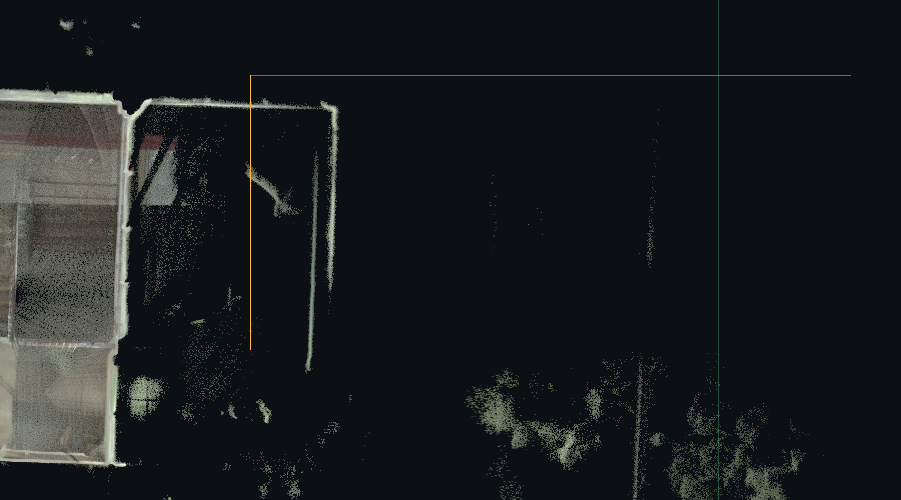
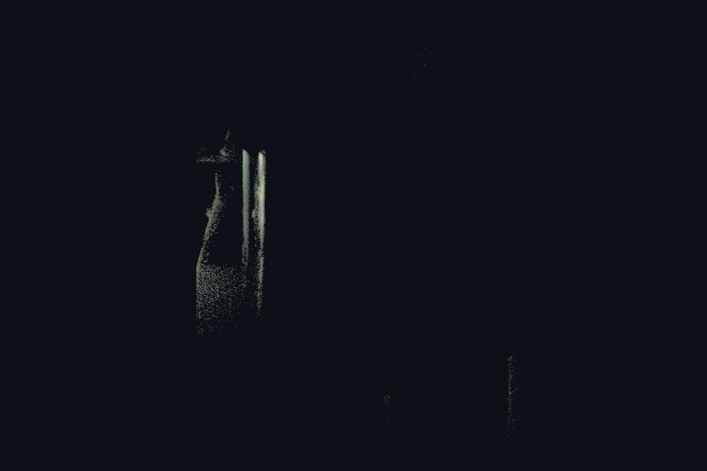
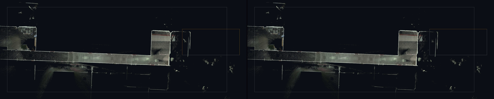
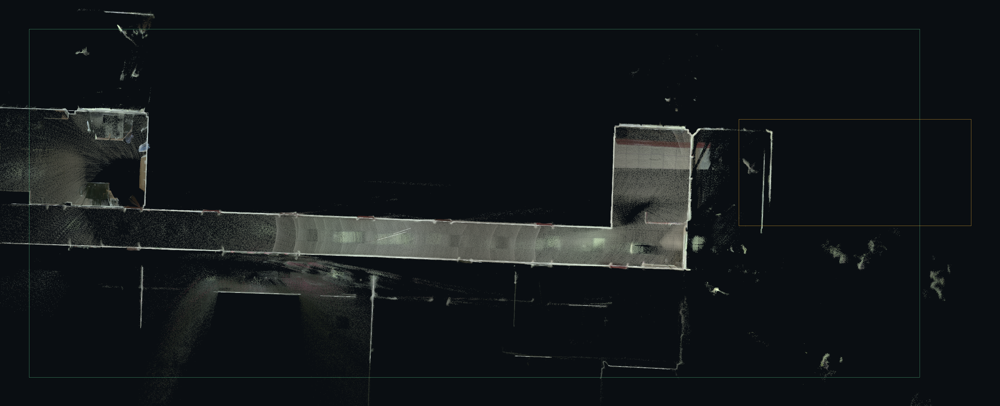
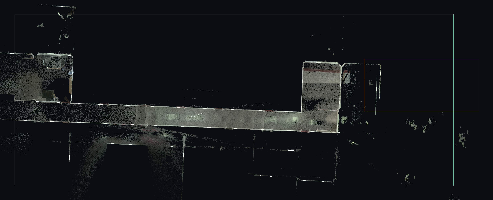
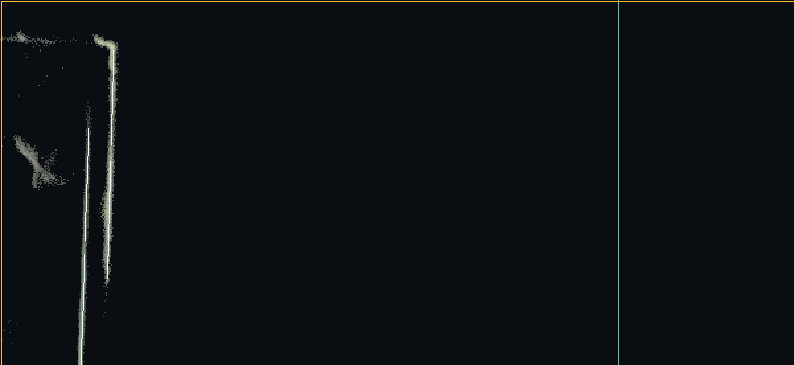
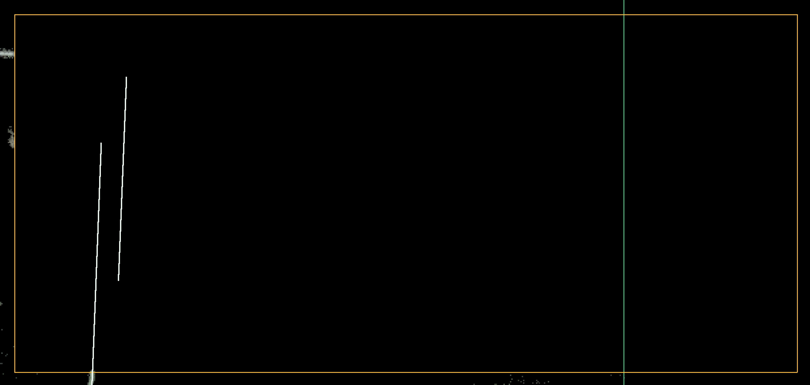

# 点云清理案例（RD-02）：真实样本东侧室外杂点框选清理与工具缺口

Issue #18 交付项。2026-11-04。本文回答三件事：**现有框选清理在真实 2000 万点样本上能完成什么、清理后墙候选链路发生了
什么变化且是否可解释、现有清理工具还缺什么**。结论分「工具可用」「工具缺口」「数据问题」三类，不把
候选数变化当作成功标准。

## 0. 前置：集成联调状态（如实记录）

Issue 要求「基于集成联调之后的代码状态开展；集成未完成时以其集成分支为准并写明」。开始本任务时：

| 对象 | 状态 |
| --- | --- |
| #13 墙候选去重合并（a） | 草稿 PR，未合并，base 为 #8 分支 |
| #14 房间提取最小面（c） | 开启，未合并，base 为 #8 分支 |
| #15 墙网连接规则（b） | 草稿 PR，未合并，base 为 #8 分支 |
| 集成分支 | **不存在** |

因此**没有**可以据以复跑的「集成后代码状态」，也没有 a+b+c 的集成分支。本案例在 PR #8 分支所依赖的
`agent/import-unit-range-check-aa8f0aa73cab`（PR #3 基线）+ `main`（0.10.4 源码）上跑：清理链路
（`cleaning.ts`、`analysis.worker.ts` 的 clean/building 分支、`wallLines.ts`）自 `main` 起未被 a+b+c
改动，清理结论不受影响；**墙候选与房间计数在 a+b+c 合入后必然变化，届时须以集成后代码重跑本文
§3、§4 的计数**（脚本已参数化，见 §6）。

## 1. 可复现口径

| 项 | 值 |
| --- | --- |
| 样本 | `tri_true_color_20260911_200108_286.pcd` |
| 大小 / 点数 | 800,000,584 字节 / 20,000,000 点（`DATA binary`，stride 40） |
| SHA256 | `6194be9e2bc4ac14f1116bbc206c56dfbec7ded45b2b07bba497904de669293a`（运行前后各算一次，未变；源件只读） |
| 单位 / 坐标系 | 米，Z 向上，样本原始坐标（未做对齐或重定向） |
| 假设参数 | 楼层标高 0 m、墙高 3 m、墙厚 0.2 m（沿用 #8 诊断的假设值，不是实测值） |
| 复跑脚本 | `windows-studio/scripts/cleanup-case-study.ts`（`npm run cleanup:case-study`） |
| 全量与否 | 全量 2000 万点解码，无抽样、无预览替代；清理在完整源点上重放 |
| 复跑耗时 | 解码 0.99 s、建筑包络 0.17 s、墙候选拟合（清理前/后各一次）0.60 s + 0.62 s（`vite-node` 实测，多次运行一致） |
| 对照基线 | #8 诊断口径（66 条候选、7116 个跨高度证据格），本次复跑一致 |

复跑命令（本机）：

```sh
cd windows-studio
SURVEY_REAL_FIXTURE=/path/to/tri_true_color_20260911_200108_286.pcd \
SURVEY_WORKSPACE=artifacts/cleanup-case-study/run \
SURVEY_REGIONS='[{"id":"A0","label":"东侧室外采集杂点（屋顶线以上）","x":[33.0,45.0],"y":[-3.0,2.5],"z":[-10,20],"basis":"包络外、屋顶线以上"}]' \
npm run cleanup:case-study
```

输出目录（不进版本库）：`cleanup-case-study.json`（全部计数与逐段对照）、`segments-before.json`、
`segments-after.json`。算法常量都在脚本与 `cleaning.ts` 中，区域与参数都在命令行里，没有隐式手工步骤。

## 2. 清理前必须解决的方法问题：建筑范围

**这是数据问题，不是工具缺陷。** 全量 30 cm 栅格显示，该样本除了主体办公楼（x ≈ −0.2…30.3，
y ≈ −5.2…3.0）之外，视野内还有：

- x ≈ 51…57、y ≈ −16…−2 的**另一处建筑/棚架**（有完整立面和楼板，约 1.5 万点/2 m 切片）；
- x ≈ 33…45、y ≈ −8…2.5 的**室外采集杂点**（树干/树冠、稀疏散射与屋顶边线）；
- x ≈ 45…51、y ≈ −10…−12 的零星漂浮点。

直接对全场景拟合会在这些结构上生成候选（试跑时 66 条候选中 6 条来自 x > 45.5 的另一处建筑）。因此脚本
先按「30 cm 栅格 → 1 m 窗口 ≥500 点/m² → 自种子点 (12.5, −2.5) 取 8 邻接连片」确定**建筑包络**
（−3.65…42.35 × −10.85…7.15，312 个窗口，828 m²），墙候选只在包络与 0–3 m 高度带内拟合。这与工程里
已有的「保留框内圈定建筑」是同一口径，本次由脚本自动完成，便于复跑。

> 工具缺口候选（见 §5-D）：框选清理没有「按建筑范围一次性圈定」的能力，用户要处理多个独立结构时只能
> 靠手工反复框选；包络/连通域判断目前只在脚本里。

## 3. 选定区域与入选证据

**区域 A0**（动手清理前在 Issue #18 回复的坐标）：

| 项 | 值 |
| --- | --- |
| X 范围 | 33.0 – 45.0 m |
| Y 范围 | −3.0 – 2.5 m |
| Z 范围 | 全部（清理时按高度带裁剪到 0–3 m） |
| 区域内点数 / 其中 0–3 m | 31,404 / 27,078 |
| 形状 | 俯视矩形 12.0 × 5.5 m（工程现有框选只能给投影矩形） |





入选理由（按证据逐条）：

1. **在建筑包络之外**：区域整体落在包络东界之外（包络右界 42.35 m），与主体东端立面之间隔 14 m 空档；
   区域内以 2 cm 栅格做连通域统计，最大连通块只有 0.3 m 宽，其余是稀疏树干、树冠与屋顶边线。
2. **不是墙体证据**：区域在 0–3 m 带内的点按 0.2 m 墙厚带度量，没有任何连续 0.8 m 以上的墙面；#8 诊断把
   该方向的低证据段（#6，墙厚带内 166 点）判为伪影，本案区域连该门槛都达不到。
3. **高度上可分**（统计口径为区域 A0 原范围 x 33.0–45.0、y −8.0…2.5 内的 2 cm 连通域）：`z > 3.2 m` 的点
   9,181 个（434 个连通块，树冠），`z ≤ 3.2 m` 的点 47,555 个（树干、薄片散射与屋顶边线）。本案**只清理
   `y ≥ −3.0` 的屋顶线以上部分**；`y < −3.0` 的树干/树冠落在 0–3 m 带内更密，留在样本中不动，避免把
   「可能是室外构筑物」的点一并删掉。
4. **与门洞无关**：区域不与任何门窗缺口、墙角或建筑入口相交，删除不会改变「门口不补墙」这一既有约束。
5. **取舍如实记录**：区域 X 起点 33.0 m 会连带切掉东端墙 #39/#47 的外侧表面点（见 §4.3 东端墙段支撑），
   选择这一范围是为了给出一个「单矩形即可复述」的区域；若改用 35.0 m 以后作起点可保留东墙外表面，但会有
   更多杂点留下，这一取舍取决于后续清理选区能力（§5-A/§5-E）。

统计上，本清理会**永久移除**区域内的真实表面点（这些点不是墙体），这一点在 §4 用墙厚带点数和东端墙段
支撑逐项核对。

## 4. 清理执行与结果

### 4.1 用了什么工具

只用工程现有的框选剔除（`RegionClipRule`：`matrix` + NDC `rect` + `mode:'remove'`，`pointInClip` 判定），
**没有改任何算法**。操作顺序与用户在界面里做的完全对应：

1. 俯视视图（正交、覆盖建筑范围），拖框 `x 33.0–45.0 / y −3.0–2.5`，模式「剔除框内」；
2. 确认前预览点数（界面显示 12 万点预览上的计数，见 §5-B），确认；
3. 高度范围「保留 0–3 m」（等价于建筑分支的剖切），使清理只作用于本案例的区域 A0；
4. 生成工程图/墙候选，复跑墙候选链路。

脚本里 3、4 两步由 `ClipState.sync()` + `fitWallLines()` 完成，与 `analysis.worker.ts` 的
`clean`/`building` 分支调用的是同一个实现；相机矩阵按「俯视正交、覆盖建筑包络」构造（`2/w、2/h、
−2cx/w、−2cy/h`），与 `CloudView` 俯视图的投影规则一致。

### 4.2 前后计数（全量）

| 级别 | 清理前 | 清理后 | 变化 |
| --- | --- | --- | --- |
| 源点 | 20,000,000 | 19,987,448 | −12,552（区域 A0 内 0–3 m 的点） |
| 建筑包络内 0–3 m 点 | 14,186,410 | 14,176,154 | −10,256 |
| 跨高度证据格（0.06 m 网格） | 7,116 | 7,061 | −55 |
| 墙候选（`fitWallLines` 输出） | 66 | 67 | +1 |
| 墙厚带内总点数（全部候选） | 15,690,103 | 16,191,493 | +3.2%（碎片重组后重复计入减少，见 §4.3） |
| 闭合房间 | 0 | 0 | 0（#8 已定位为墙网/连接/判定问题，清理不能改变） |

清理前/后同一俯视范围、同一配色（左 = 清理前，右 = 清理后）；白线为墙候选，绿框为建筑包络，橙框为
区域 A0。图幅较宽，区域 A0 的放大对照见后两张。











计数解释：

- **−12,552 点**：区域 A0 的点按「框选矩形 ∩ 0–3 m」精确计数为 12,552，与规则实际删除数一致
  （区域 31,404 点中 `y < −3.0` 的树干/树冠和 `z > 3.0` 的树冠不在清理范围内，共 18,852 点保留）。
- **−10,256 点（包络内 0–3 m）**：区域 A0 的 `x 33–42.35` 落在包络内，这部分是屋顶线以下的室外表面点；
  `x 42.35–45` 在包络外，不计入该列。两列的差 2,296 点即区域 A0 与包络的交集余量。
- **−55 个证据格**：删除后该带内跨高度点云变薄，少量格不再满足「≥8 点、高差 ≥0.8 m、≥4 个高度层」。
- **66 → 67 条候选**：最长两段由 #1（30.45 m）+ 其同轴碎片（#0 等，合计 48.54 m 的 A 组）重组成 **35.58 m**，
  #4（12.61 m）与 #5（8.53 m）重组成 **11.58 m** 与 **8.42 m**；这不是清理把墙「变多/变长」了，而是 RANSAC
  在点云变化后重新分段（#8 已记录同一面墙会被切成不同粒度）。墙厚带内总点数反而上升 3.2%，是重复段减少后
  同一面墙不再被多段重复计入的结果，不代表新增了墙面证据。

### 4.3 逐段对照与「是否误删真实墙」

**先说度量口径**：`fitWallLines` 的候选粒度会随点云变化重组（#8 已记录：重复拟合 + 内点删除导致同一面
墙被切成若干段），所以「清理后少了几条候选」不能直接当作「墙被删了」。本案用墙轴匹配：方向差 ≤3°、
中轴平行距离 ≤5 cm、沿轴投影覆盖 ≥60%、首尾间隙 ≤0.3 m，且两侧互为候选才记为同一个墙段。

| 对照结果 | 数量 | 说明 |
| --- | --- | --- |
| 唯一的墙轴匹配（同一墙段） | 39 | 主力墙面（#1、#4 等）全部在内，中轴平行距离 0–0.042 m，沿轴覆盖 ≥0.66 |
| 清理前有、清理后无匹配 | 27 | 全部是同一墙轴上的碎片被重组；逐条给出「最近的同轴后段」，无一条对应真实墙段整体消失 |
| 清理后有、清理前无匹配 | 28 | 同上，另一种粒度 |

**区域 A0 内部**：区域内只有一条候选（x ≈ 34.6–34.7 的东端内墙 #47，3.58 → 3.12 m），清理前后都是同一条
候选；区域内没有整段丢失、也没有新长出的候选。但 #47 的**证据被削弱**（见下表），这与「候选还在」并不矛盾。

**东端墙段支撑**（区域 A0 之后，x > 33 的候选在墙厚带内的真实点数）：

| 墙段 | 清理前墙厚带内点（x>33） | 清理后 |
| --- | --- | --- |
| #39 东侧低密度墙（34.2→34.3，3.84 m） | 13,260 | 10,634 |
| #47 东侧横墙（34.6，3.58 m） | 11,302 | 4,945 |

两段墙在清理后仍然存在、长度基本不变（#39 3.84 → 3.84 m、#47 3.58 → 3.12 m），墙厚带内点数下降是**区域 A0 曾包含这两段墙的
东侧部分表面点**（区域从 x 33 起、覆盖到 y 2.5，正好切掉东墙外侧的一部分）。这是**本案区域取舍造成的
真实点损失**，不是伪影清理：墙体证据仍充足（>4,900 点/段），但东墙外侧表面不再完整。若要把这两段墙的
外表面完整保留，区域 X 起点应改到 35.0 m 以后——见 §5-E 的「选区形状」缺口。

**数据问题**：#6 类伪影段（墙厚带内 166 点，位于 x ≈ −4.6…−3.7 / y ≈ −1.95）不在本案区域内，清理前后
都在（墙厚带内点数见 JSON），因此本案例**没有**消除 #6；消除 #6 需要围绕该小段做局部清理，属于另一个
区域选择。

## 5. 工具缺口清单（现有框选清理的实测缺口）

每条给出复现步骤与影响分级（高 = 让清理结果不可信或不可复现；中 = 显著增加操作成本；低 = 体验问题）。

### A. 选区只能是矩形、且穿透全部深度（高）

- 现状：`CloudView.tsx` 的「选区」只产生 NDC 矩形；`cleaning.ts` 的 `RegionClipRule` 只有 `matrix+rect`，
  投影规则覆盖相机前后裁剪面之间的**全部深度**（README 0.3 节明确「框选穿透当前视线全部深度」）。
- 复现：俯视图框选主体东侧 12 m × 5.5 m 区域 → 结果同时删除该框内**所有高度**的点，屋顶线以下 10,256 个
  室外表面点一并删除；本案只能用「先高度剖切 0–3 m，再框选」两步拼出「屋顶线以上」这一形状。
- 影响：任何「只删这一层」或「只删这个面」的意图都无法用一次框选表达；本案东端墙的外表面点就是这样被
  连带删除的（§4.3）。

### B. 预览点数不是真实影响点数（高）

- 现状：`CloudView` 只在 12 万点预览样本上高亮并计数（`highlightRef`），`ClipState.sync` 才在完整源点上
  真正删除；界面提示「预览 N 点」与「已应用 M 次清理」，没有把「本次将删除多少个源点」在确认前给出。
- 复现：框选区域 A0 时预览显示 12 万预览点中的框内数（数百级），确认后实际删除 12,552 个源点，差两个
  数量级。
- 影响：用户无法在确认前判断是否误选——正是本案「区域从 x 33 起会切掉东墙外表面」这类错误最难看出的地方。

### C. 清理结果的可见性与前后对照缺失（高）

- 现状：删除后点云直接从预览消失，工程只记录 `clips` 规则；没有「被删点在哪、删了多少、清理前后对照」
  的界面内视图。撤销是规则级（`editHistory`），重做栈只在当前会话保留（README 0.3.2 已写明）。
- 复现：清理区域 A0 后，唯一能确认「删掉的是杂点而不是墙」的办法是重新打开源件、手工对比或跑外部脚本。
- 影响：本案 §4.3 的逐段核对与东端墙支撑核对**只能靠脚本完成**，产品内没有对应能力；用户清理后无法
  自证没有误删。

### D. 没有「按建筑范围/连通域圈定」（中）

- 现状：只能手拖矩形；本案样本里有另一处建筑（x 51–57）和两处室外结构，要圈定主体只能反复框选或手工
  判断范围。
- 影响：框小了墙候选会丢，框大了会把相邻结构当墙；`fitWallLines` 对 >8,000,000 格、>100,000 证据格的
  输入直接报错，用户很难判断该框多大。

### E. 选区不能按 Z 或按通道扩展（中）

- 现状：高度范围是「保留」，不是「仅在范围内剔除」；想做「只在 0–2 m 内剔除」需要先保留再剔除，步数翻倍
  且中间状态在预览上不可见。
- 影响：本案的区域 A0 必须依赖「先保留 0–3 m、再框选」两步；界面上无法把两步合成一条可复述的规则。

### F. 撤销/重做的会话边界（低）

- 现状：撤销可跨会话（规则逐条撤），重做栈只在当前会话（README 0.3.2）。
- 影响：跨会话修正一次误清理后无法再撤回「撤销」，只能重做清理。

### G. 关键帧/图纸联动在清理后不更新（中）

- 现状：清理后 `drawing` 标记为过期（`setStale(true)`），但已打开的派生图纸、关键帧复核的墙带/候选仍是
  清理前的几何；界面上没有「这些成果依赖旧点云」的逐项提示。
- 影响：本案清理后重新生成图纸前，旧图纸里的墙段仍是清理前的 66 条，容易与复核结论混淆。

> 以上缺口**没有一个是单一局部改动**：A、B 需要改 `ClipRule` 契约与 `CloudView` 预览逻辑，C 需要新的
> 对照视图，D 需要连通域/范围建议，G 需要成果失效提示。按 Issue 的范围约定，本任务**只交清单与拆分建议**，
> 不在本任务内提交最小修复 PR（见 §7）。

## 6. 工程保存与重开（验证范围）

本机是 Linux 无显示环境，**Windows/Electron 实机运行未验证**，不冒充已验证。已做的验证：

| 验证 | 方式 | 结果 |
| --- | --- | --- |
| 清理规则可持久化 | `encodeProject`/`decodeProject` 往返（`tests/cleaning-walls.test.ts`） | 通过：`clips` 原样恢复 |
| 清理只作用于工程内数据 | 脚本运行前后两次 SHA256 | 一致（`6194be9e…293a`） |
| 桌面流式工程（v2/v3）是否保存 `clips` | 读 `electron/source-store.cjs` `saveProject`/`openProject` | manifest 整体透传 `source.clips`，与 README 一致；**未在 Windows 实机保存/重开** |
| 重开后墙候选 |

工程保存/重开的**实机**步骤（Windows，待执行）：

1. 导入原件 → 俯视框选区域 A0 → 确认剔除 → 保存 `.pvplan`；
2. 关闭并重开工程 → 核对「已清理」点数 = 19,987,448、清理次数 = 2（框选 1 次 + 高度保留 1 次）；
3. 生成工程图 → 墙候选数应为 67（与本文一致）→ 保存后再次重开，候选与图纸一致。

本任务**没有**执行上述实机步骤，本文不声称「工程可恢复」已实测通过。

## 7. 结论

| 类别 | 结论 |
| --- | --- |
| **工具可用** | 现有框选剔除（投影矩形 + 穿透深度）确能在完整 2000 万源点上删除选定区域（12,552 点），规则可复现、可撤销、源件不变；清理后墙候选链路可正常复跑，主力墙段全部保留，区域 A0 内没有候选因清理而丢失或新增。 |
| **工具缺口** | §5 的 7 条，A/B/C 为高：选区形状与深度不可控、影响点数不可见、清理结果与前后对照不可见。本案的「东墙外表面被连带删除」正是 A+B 共同作用的结果。 |
| **数据问题** | 样本内有另一处建筑与两处室外结构，全场景拟合会混入非主体候选（试跑 66 条中 6 条在 x > 45.5）；建筑范围需要先圈定。此项属数据/使用方式问题，不是清理工具缺陷。 |
| **未达到的验收** | 清理**没有**消除 #6 伪影段（不在本区域内）；闭合房间 0→0，因为房间为 0 的原因是墙网/连接/判定（#8 已定位），不是清理能解决的。 |

**拆分建议（供排期，不在本任务实施）**

1. 选区形状（对应 A）：`RegionClipRule` 增加多边形与「表面/穿透 + 厚度」两种深度模式，与
   `point-cloud-editing-design.md` 的画笔/表面契约合并设计，避免矩形与画笔两套深度语义。
2. 影响点数（对应 B）：在 Worker 侧对完整源点预演一次规则并回传影响点数，确认前展示；不要求 12 万预览等于
   真实影响。
3. 清理对照视图（对应 C）：清理前后同视角截图或差分高亮（已删点用灰/红显示），支持逐条规则对照。
4. 范围建议（对应 D）：按连通域/密度给出「建筑范围」建议，由用户确认后再拟合。
5. 成果失效提示（对应 G）：清理后把派生图纸、关键帧墙带标记为「依赖旧点云」，并在成果包里记录。
