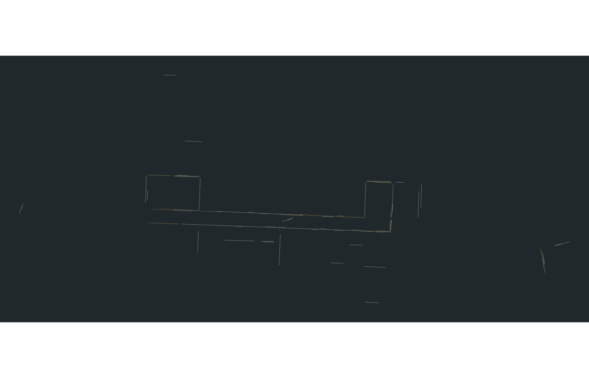
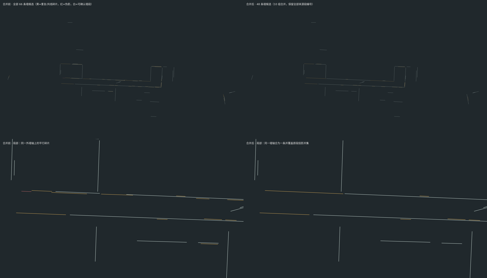
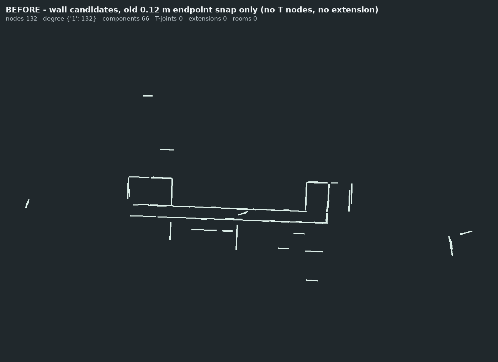
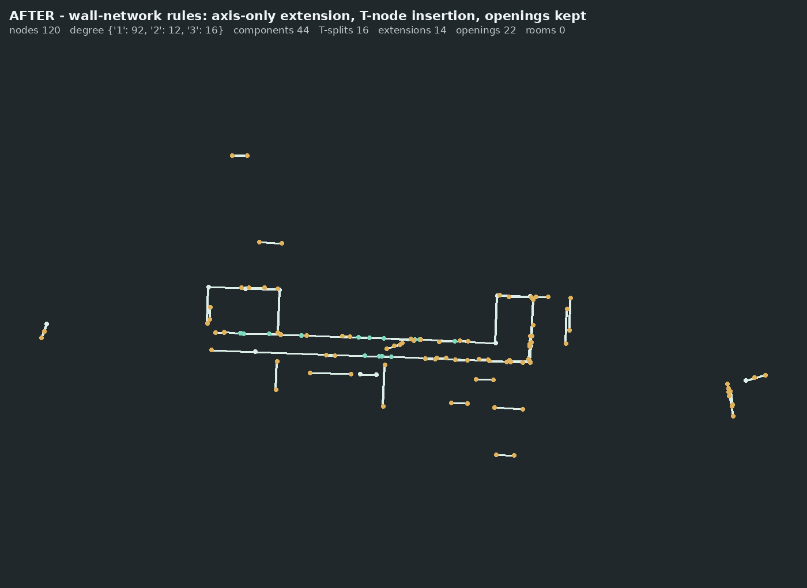
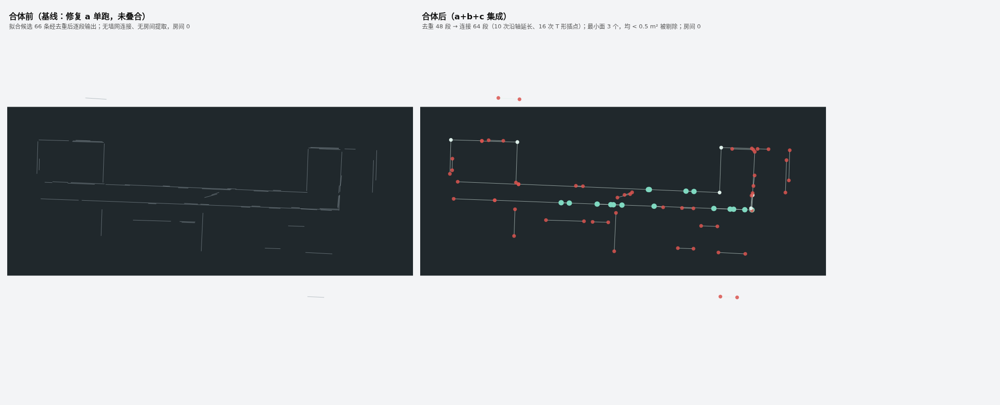
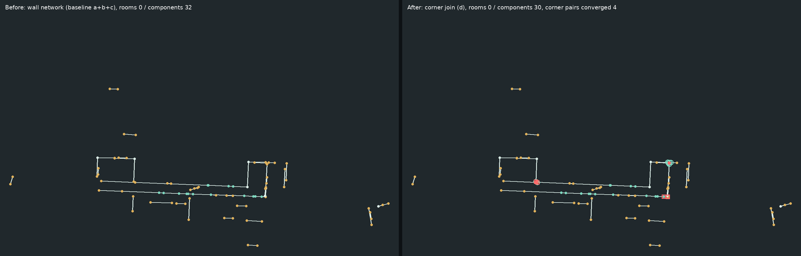
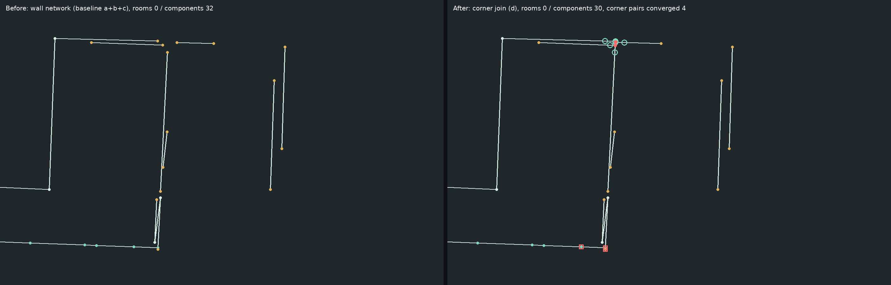
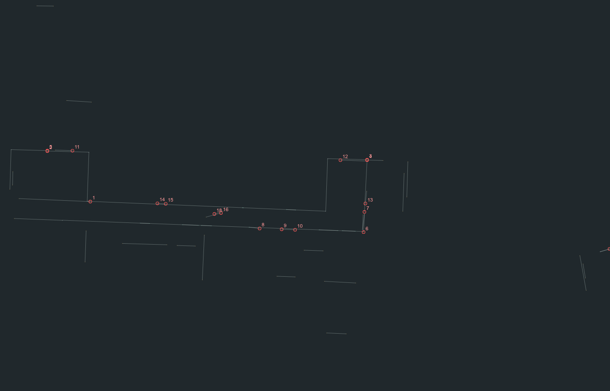
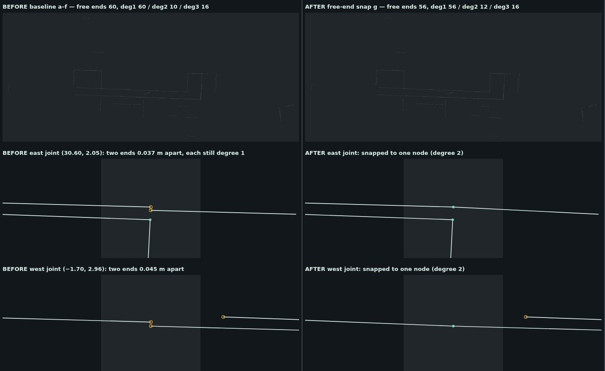

# 墙网与房间闭合诊断（真实样本）

本文回答两个问题：**真实样本的墙候选各是什么、为什么闭合房间为零**。结论只用于功能诊断：
RD-01 的独立真值与误差阈值尚未提供，本文的分类是"功能分组"而不是精度验收，也没有据此放宽任何判定阈值。

## 1. 复跑口径

| 项 | 值 |
| --- | --- |
| 样本 | `tri_true_color_20260911_200108_286.pcd` |
| 大小 / 点数 | 800,000,584 字节 / 20,000,000 点 |
| SHA256 | `6194be9e2bc4ac14f1116bbc206c56dfbec7ded45b2b07bba497904de669293a`（复跑前后未变，源件只读） |
| 假设参数 | 标高 0 m、墙高 3 m、墙厚 0.2 m |
| 复跑方式 | `windows-studio/scripts/diagnose-room-closure.ts`（`npm run diagnose:room-closure`），全量 2000 万点，无子集、无预览替代 |
| 耗时 | 解码 1.01 s、墙线拟合 0.70 s（仅候选生成，不含导入与交付） |
| 基线代码 | `agent/import-unit-range-check-aa8f0aa73cab`（PR #3 评审分支；#3 尚未合并，本任务依赖该分支，未混入 PR #5 与 CAD 修订改动） |

原始运行结果：`artifacts/room-closure/<样本名>/diagnosis.json`（逐段几何、证据、分类、链缺口）、
`segments.json`（拟合墙段）、`walls.svg`（按类别着色的墙网）。该目录不进版本库，可用
`SURVEY_REAL_FIXTURE=<原件> npm run diagnose:room-closure` 复算。

墙网视图（白=可确认墙段，黄=重复/共线碎片，红=伪影）：各段首尾零散、中下部可见一条与墙轴方向不符的
斜线，正是 §4.2 端点拼接把两段墙的端点直接拉成一条斜线的结果。



本次复跑得到 **66 条墙候选、0 个自动识别门窗、0 个闭合房间**。与 Issue 记录的 55 条不同：候选数来自
RANSAC 的伪随机抽样（固定种子 `1234567`），但抽样结果取决于点云本身；55 是早前某次运行的记录值，
66 是当前基线与该原件的复算值。两者相差主要落在短碎片上（见 §3.3），不影响下文结论。

## 2. 链路逐级计数

| 级别 | 计数 | 判定 |
| --- | --- | --- |
| 源点 | 20,000,000 | — |
| 0–3 m 高度带内点 | 14,260,310 | 通过 |
| 跨高度证据格（0.06 m 网格，≥8 点、高差 ≥0.8 m、≥4 个 25 cm 层） | 7,116 | 通过 |
| 网格总数 1,085,088（上限 8,000,000） | 通过 |
| RANSAC 轮次 60/60（每轮均选出直线） | 60 条直线 | 通过 |
| 内点 → 投影排序 → 分段：片段 66 段 | ≥0.8 m 且 ≥10 格的全部保留 | 通过 |
| 被丢弃的片段 | 支撑格 1–9 的 210 段（最长的 0.86 m）、支撑格 ≥10 但长度 <0.8 m 的 37 段 | 见 §4.1 |
| 墙候选（`fitWallLines` 返回） | **66** | 通过 |
| 端点连接（`wallLines.ts` 内 0.12 m 交点拼接） | 131 个节点、130 个只连 1 条墙、1 个连 2 条 | 仅形成 1 处 2 度节点 |
| 墙网连通分量 | 65 个，最大分量 1 条墙 | 失败：无 ≥3 墙的分量 |
| 闭合环（`roomsFromWalls` 要求分量内全部节点度为 2） | 0 | 失败：65 个分量全部在"分量过小"淘汰 |
| 房间 | **0** | — |

`analysis.worker.ts` 的 building 分支先按标高/墙高剖切，再 `fitWallLines` → `buildingFromSegments` → `roomsFromWalls`，
因此上表即用户看到的"66 条墙候选和 0 个闭合房间"。

门窗为 0 属于预期行为而不是缺陷：`buildingFromSegments` 不自动识别门窗（`buildingOps.ts` 的 assumptions
明确"门窗不从点云缺口自动推断"），门窗只能由 `wallElevation.ts` 的立面候选经用户确认后生成。本次未改这条链路。

## 3. 66 条候选分类（计数闭合：35 + 30 + 1 + 0 = 66）

分类依据：**墙厚带内点数**决定能否确认成墙（>500 点）；**0.45 m 带宽内点数 / 证据格**决定是否为孤立伪影
（<300 点/格）；同一共线组（方向差 <1.5°、间距 <0.15 m、投影相接 <0.5 m）保留最长的一段，其余记为重复/碎片。
每条候选的坐标、长度、证据格数、墙厚带内点数与判定依据见 `diagnosis.json` 的 `segments` 数组（字段
`index/a/b/lengthM/angleDeg/supportCells/pointsInThickness/pointsNearBand/rmsMm/category/basis`）。

### 3.1 可确认墙段（`wall`，35 条）

墙厚带内点数从 530 到 4,068,742，跨高度证据 14–872 格。其中 22 条长度 ≥1.9 m 且墙厚带内点数 >2000，
属于可定位的主要墙面；#43、#46、#55、#59、#60、#61 六段墙厚带内点数仅 530–1598，虽高于伪影门槛，但缺独立真值，
只能确认"有一段墙面证据"。
代表：

| 候选 | 长度 m | 端点（x, y） | 证据格 | 墙厚带内点 | 说明 |
| --- | --- | --- | --- | --- | --- |
| #1 | 30.45 | (−0.19, −4.08) → (30.24, −5.23) | 872 | 4,068,742 | 最长外墙 |
| #4 | 12.61 | (4.92, −2.23) → (17.52, −2.77) | 362 | 2,559,905 | 与 #1 平行的内侧墙 |
| #44 | 4.99 | (26.42, −2.97) → (26.60, 2.01) | 153 | 586,062 | 东侧横向墙 |
| #36 | 4.63 | (2.33, −1.97) → (2.49, 2.66) | 135 | 614,169 | 西侧横向墙 |
| #34 | 4.55 | (13.95, −10.11) → (14.16, −5.57) | 135 | 76,516 | 远离主体的隔墙 |
| #45 | 3.85 | (−5.49, −0.94) → (−5.37, 2.91) | 94 | 12,629 | 西侧低密度墙 |
| #39 | 3.84 | (34.20, −3.16) → (34.33, 0.68) | 106 | 13,260 | 东侧低密度墙 |

### 3.2 重复或共线碎片（`duplicate`，30 条）

同一共线组内保留最长段后，其余段与保留段平行重叠（间距 0.02–0.15 m、方向差 <1.5°）。集中在三组：

| 共线组 | 段数 | 合计长度 m | 成员 |
| --- | --- | --- | --- |
| A（#1 所在外墙） | 12 | 48.54 | #1、#0、#30、#15、#13、#33、#16、#32、#28、#14、#29、#31 |
| B（#4 所在内墙） | 7 | 30.49 | #4、#5、#9、#23、#8、#24、#51 |
| C（#27 所在墙） | 4 | 8.73 | #27、#26、#52、#53 |
| D（#3 所在墙） | 3 | 9.05 | #3、#7、#2 |
| E（#17 所在墙） | 3 | 10.82 | #17、#20、#21 |
| F（#18 所在墙） | 3 | 9.45 | #18、#22、#38 |
| G（#50 所在墙） | 3 | 5.18 | #50、#54、#49 |

这些段不是独立墙体：同一位置的证据被 RANSAC 按不同"直线"重复分配，每条重复线又因 `wallLines.ts`
在吸收内点后从证据格数组中删除对应点，使相邻的真实墙段被切成更短的碎片（例如 A 组中 #0、#30 等）。
**后果是同一道墙在墙网中出现两道平行墙，闭合环被拆成两支**（§4.3）。

### 3.3 过短碎片（计入 `wall`/`duplicate` 的 <1.0 m 段）

0.8–1.0 m 的候选共 9 条：#6（伪影）、#25、#49、#51、#53、#63（重复/碎片）、#31、#60、#64（可确认墙）。
它们多数是上一轮重复分配的残段，长度刚过拟合器下限（0.8 m）与支撑门槛（10 个证据格）；其中 #6 因证据
稀疏被单独判为伪影（见 3.4）。这类碎片对闭合没有帮助，只增加节点。

### 3.4 玻璃或反射伪影（`artifact`，1 条）

| 候选 | 长度 m | 端点（x, y） | 证据格 | 墙厚带内点 | 0.45 m 带宽内点/格 |
| --- | --- | --- | --- | --- | --- |
| #6 | 0.90 | (−4.57, −1.94) → (−3.67, −1.97) | 13 | 166 | 18 |

墙厚带内仅 13 点/格、0.45 m 带宽内也只有 18 点/格，且位于 #0 端点附近：更像短反射面或噪声拼接，
不足以确认成墙。本次只有 1 条达到这一判定。

### 3.5 非墙结构

真实样本中未出现与建筑无关的大面积结构（树木、人等）达到墙候选门槛的独立段；#45、#39、#34、#48 等位于
主体东西两侧，密度低但与主体墙轴平行，按"低证据墙体待复核"计入 3.1 而不是非墙结构。

### 3.6 无法判定

0 条。但 3.1 中的低密度段（墙厚带内点数 ≤2000，共 #43、#46、#55、#59、#60、#61）缺独立真值，只能确认
"点云证据支持有一段墙面"，不能确认属于室内隔墙、外墙还是室外构件；它们按未复核墙体（`inferred`）保留，需人工复核。

## 4. 零闭合原因：逐阶段定位

### 4.1 数据问题：同一面墙被重复拟合，且被切成碎片（`wallLines.ts: fitWallLines`）

`fitWallLines` 每轮用随机种子选最好的直线（`tolerance = .045`），然后**把所有落在该直线 4.5 cm 内的证据格
从数组中删除**（`points = points.filter(...)`，`wallLines.ts` 第 62 行）。当一面墙有 0.3–0.5 m 的厚度证据或
两轮直线的角度略有差异时，剩余证据会形成与已选直线并行的第二条直线，于是同一面墙被输出 2–12 条平行段。
本次 35 条可确认墙段加 30 条重复段即由此产生；重复段的存在使得同一位置出现两道平行墙，闭合环被拆成两支。

### 4.2 算法/参数问题：端点拼接只处理"两条非平行线在 12 cm 内相交"（`wallLines.ts` 第 65–72 行）

拼接条件是 `distance(a[ak], p) <= .12 && distance(b[bk], p) <= .12`，且只判断两条墙端点与**交点**的距离。
本样本 66 个悬空端的最近墙轴缺口分布为：≤0.12 m 的 39 个，0.12–0.5 m 的 14 个，>0.5 m 的 13 个。也就是说，
**0.12 m 以外的缺口一律不连接**，而 0.3 m 级的缺口正是同一道墙两段之间的拟合抖动（§4.1 的伴生现象）。
另外该步骤只移动端点坐标，不生成中间节点，因此一段墙的端点即使落在另一面墙中部（丁字）也不会形成 2 度节点，
而是把两面墙的端点直接拉成一条斜线，这在真实样本上表现为 `walls.svg` 中与墙轴方向不符的短斜段。

### 4.3 判定问题：房间提取只接受"分量内全部节点度为 2"的独立墙环（`buildingOps.ts: roomsFromWalls`）

```
if(component.length<3 || component.some(e=>ends[e]!.some(n=>adjacent[n]!.length!==2)))continue;
```

这一段要求**整条连通分量**的所有端点度数都恰好为 2。真实建筑里：内隔墙与外墙相接形成 T/十节点（度 3、4）、
两面墙共享一段内墙形成两个房间、墙端因门口而悬空——任何一处不满足，整个分量都被丢弃。本样本 65 个分量
全部在 `component.length<3` 被淘汰（每个分量只有 1 条墙）；即使用户手工把重复段删掉，剩下的主链也仍是
一条 43 面墙的开链（见 `diagnosis.json` 的 `components`），会继续在"度数非 2"处被淘汰。

### 4.4 失败定位汇总

| 阶段 | 函数 | 通过 | 失败 | 性质 |
| --- | --- | --- | --- | --- |
| 高度剖切 | `analysis.worker.ts` building 分支 | 14,260,310 点 | — | 通过 |
| 证据格 | `wallLines.ts: fitWallLines` | 7,116 格 | — | 通过 |
| 直线与分段 | 同上 | 66 段 | 重复段 30 条、碎片 8 条 | **数据/算法**：并行重复拟合、内点删除后重新分配 |
| 端点连接 | `wallLines.ts` 第 65–72 行 | 1 处 2 度节点 | 130 个悬空端，其中 14 个缺口在 0.12–0.5 m | **参数**：0.12 m 容差只覆盖角点，不覆盖墙缝 |
| 墙网 | `buildingOps.ts: roomsFromWalls` | — | 65 个分量全部无环 | **算法**：只接受全域度为 2 的独立环 |
| 房间 | 同上 | 0 | 0 | — |
| 门窗 | `wallElevation.ts` | 不自动运行 | — | 设计如此，非缺陷 |

## 5. 夹具

`windows-studio/tests/room-closure.test.ts` 用合成数据复现主要失败模式，既有的 8×6 m 结果（4 墙、1 房间、
净面积 7.8×5.8 = 45.24 m²）作为回归基线保留。在基线上，失败模式 1（0.3 m 墙缝视为断开）与失败模式 3
（两房间共享内墙只得到 1 个房间）当前为失败状态，即夹具确实捕获了 §4.2、§4.3 的问题。

## 6. 最小修复的边界

诊断指向**两个及以上**的独立原因：拟合重复（§4.1）、连接容差（§4.2）、房间判定口径（§4.3）。
按 Issue 的范围约定，只有症状是单一局部原因时才在同一任务内提交最小算法修复。这里任何一项单独修改都
不能把真实样本从 0 房间变成稳定闭合：只放大连接容差会把门口补成墙（夹具"失败模式 4"就是防止这种改法）；
只改房间判定会把重复墙当成房间的边界。因此本任务提交诊断、夹具与复跑工具，并把修复拆分建议列在 §7，
不擅自改动判定阈值、不以候选数或合成结果替代真实样本结论。

## 7. 后续拆分建议（供负责人排期）

1. **拟合去重**（对应 §4.1）：在 `fitWallLines` 输出后按共线段合并（同一墙轴、间距 <0.15 m 的平行段合并为一段，
   记录原段数与合并长度），或改为"生成候选后再统一选优"，避免内点删除造成的二次分配。该改动只对墙线候选
   做后处理，不改变 RANSAC 抽样，可直接用 `room-closure.test.ts` 与真实样本复跑对比候选数。
2. **连接规则**（对应 §4.2）：把端点连接改成墙网级规则——端点间缺口 ≤0.5 m 且沿墙轴对齐时延长到交点，
   端点落在另一墙轴内部时在该处插入节点（T 丁），门口等 ≥1 m 缺口不连接。该规则需要负责人确认"连接容差"
   这一功能参数（不是精度阈值），并与"门洞不补墙"的既有约定一起评审。
3. **房间判定口径**（对应 §4.3）：由"全域度为 2 的独立环"改为平面图最小面（每个有向半边按顺时针取下一个
   邻边），使 T/十/多房间网络都能出房间；同时保留缺墙区域作为"未闭合问题"输出，而不是直接丢弃。
4. 三项修复完成后重跑本脚本，以候选数/节点度数/连通分量/闭合环/房间逐级计数对比修复前后，并把真实样本的
   房间数与人工复核结果一起报告。

## 8. 修复 a：墙候选去重合并（PR #13）

诊断 §7.1 的"拟合去重"已按零闭合三步的第一步落实：在 `fitWallLines` 拟合输出之后、墙网连接之前（集成后的顺序，见 §10）：
由 `src/pipeline/wallDedupe.ts` 的 `mergeWallSegments` 把同一墙轴上的平行重复段合并为一条。
RANSAC 抽样、内点删除、0.12 m 端点连接、`roomsFromWalls` 判定以及 CAD/核验/设备协议均未改动。

判据是**功能参数**（多大间距仍算同一道墙），不是精度阈值，也没有 RD-01 真值据以认证：

| 常量 | 值 | 含义 |
| --- | --- | --- |
| `DEDUPE_DIRECTION_DEG` | 1.5° | 方向差：与组内每段都小于该角度才可归为一组（相对于骨干段，避免链式传递） |
| `DEDUPE_AXIS_GAP_M` | 0.15 m | 轴间距：来源段两端到组内每段轴线的垂直距离都小于该值 |
| `DEDUPE_PROJECTION_GAP_M` | 0.02 m | 投影重叠或相接：诊断口径允许 0.5 m 空隙，合并按任务口径只接受重叠/相接，2 cm 作为浮点与相接容差 |

代表轴取法：**组内最长段为骨干**，骨干方向即合并方向；轴位置由全部来源端点相对骨干轴的横向偏移按
来源段长度加权平均（长段更能代表这面墙的轴线）；范围取全部来源端点投影的并集，组内投影不连续时按空隙拆开。
合并结果用 `sources` 保留全部来源段编号，支撑格取来源之和、RMS 按支撑格加权；绘图实体
`OBSERVED_WALL` 的 `metadata.sourceWalls` 记录同一来源编号，`model.parameters` 增加
`fittedSegments`（拟合原始段数）与 `mergedWallGroups`（合并组数，`fittedSegments` 表示拟合阶段段数）。

### 8.1 真实样本复跑（同一原件、同一 SHA256）

`SURVEY_REAL_FIXTURE=<原件> npm run diagnose:room-closure`，源件 SHA256
`6194be9e…669293a` 复跑前后不变。链路计数：

| 项 | 合并前 | 合并后 |
| --- | --- | --- |
| 拟合输出（`fitWallLines` 拟合段） | 66 | 66 |
| 去重合并组 | — | 10 组 |
| 墙候选（`fitWallLines` 返回） | 66 | **48** |
| 分类：可确认墙段 / 重复碎片 / 伪影 | 35 / 30 / 1 | 31 / 17 / 0 |
| 墙网节点（0.2 mm 合并） | 131 | 96 |
| 连通分量 / 闭合环 / 房间 | 65 / 0 / 0 | 48 / 0 / 0 |

合并前 30 条重复碎片中 17 条并入了主段，另 13 条保持独立（原因见 §8.3）。房间仍为 0：本次只做去重，
连接规则（§4.2）与房间判定（§4.3）尚未修复，符合三步修复的范围约定。

### 8.2 逐组对照（合并后范围 = 各来源段投影并集）

| 组 | 来源段 | 骨干 | 合并后范围（x, y）m | 长度 m | 投影覆盖 | 来源段到合并轴最大偏移 m |
| --- | --- | --- | --- | --- | --- | --- |
| 0 | #1, #28, #29, #30 | #1 | (−0.186, −4.066) → (30.245, −5.214) | 30.452 | 1.000 | 0.088 |
| 1 | #4, #8, #9, #23, #24 | #4 | (2.637, −2.160) → (18.106, −2.812) | 15.483 | 1.000 | 0.079 |
| 2 | #5, #10 | #5 | (17.995, −2.798) → (26.515, −3.157) | 8.527 | 1.000 | 0.067 |
| 3 | #27, #53 | #27 | (30.326, −3.223) → (30.577, 1.681) | 4.911 | 1.000 | 0.110 |
| 4 | #2, #3, #6, #7 | #3 | (−4.562, −1.875) → (2.510, −2.173) | 7.079 | 1.000 | 0.061 |
| 5 | #17, #21 | #17 | (−1.300, 2.930) → (2.431, 2.830) | 3.732 | 1.000 | 0.045 |
| 6 | #18, #22 | #18 | (26.648, 2.171) → (30.232, 2.075) | 3.586 | 1.000 | 0.040 |
| 7 | #49, #50, #54 | #50 | (52.087, −7.646) → (52.725, −11.185) | 3.597 | 1.000 | 0.051 |
| 8 | #12, #42 | #12 | (11.397, −6.627) → (13.244, −6.682) | 1.849 | 1.000 | 0.055 |
| 9 | #63, #65 | #65 | (−23.813, −2.555) → (−23.311, −0.993) | 1.641 | 1.000 | 0.049 |

核对方法（脚本内逐组执行，结果写入 `diagnosis.json` 的 `dedupe.groupDetail`）：把每个来源段的两个端点
垂直投影到合并轴上，检查 ①投影位置落在合并段首尾之间（`originalsInsideMerged: true`、
`maxOutsideM = 0`），②横向偏差（`maxSourceSideOffsetM`）均小于 0.15 m 判据。10 组全部通过。

### 8.3 预期 7 组、实际 10 组的原因

诊断口径的共线簇允许投影间 0.5 m 空隙（`gap < .5`），本任务口径只接受"投影重叠或相接"（2 cm 容差）。
把 13 条合并后仍独立、但合并前属于诊断共线簇的碎片按同轴/投影关系分类，逐条核对如下：

| 独立碎片 | 最近同轴段 | 轴距 m | 投影间隙 m | 原因 |
| --- | --- | --- | --- | --- |
| #0 | #1（A 组骨干） | 0.097 | 0.36 | 投影间隙超 2 cm |
| #13、#14 | #13 ↔ #14 互相 0.000 | — | 0.30 | 两者之间是门洞级空隙 |
| #15、#16 | 互相 0.000 | — | 0.42 | 同上 |
| #20 | #17（E 组骨干） | 0.079 | 0.80 | 同上 |
| #31、#32、#33 | #0 | 0.088–0.092 | 8.2–22.5 | 同上（A 组内部的门洞级空隙） |
| #26、#52 | #27 / #53（C 组） | 0.10–0.16 | 0.16–0.30 | 投影间隙超判据；#52 与 #27 的相对方向差 1.2° |
| #51 | #23 / #10（B 组） | 0.145 | 0.30 | 同上，且轴距接近判据 |
| #37 | #21（E 组骨干） | 0.02–0.11 | 0.30 | 投影间隙超判据 |
| #38 | #18（F 组骨干） | 0.103 | 0.51 | 同上 |
| #61 | #54 | 0.122 | 0.00 | 方向差 0.72°，但在组内的相差使组内两两判据不成立 |

因此按"重叠或相接"口径，A 组合并为 2 组（#1 组、#2/#3/#6/#7 组），B 组合并为 2 组（#4 组、#5/#10 组），
C、D、E、F、G 各合为 1 组，共 10 组；其余 13 条碎片因门洞级空隙或轴距超判据保持独立输出，符合任务
"不属于同组的一条不得合并"的要求，没有靠放宽判据把它们并入。

诊断预期"7 组各合为 1 条"是按 0.5 m 投影链得到的结果；若后续确认 0.5 m 内的同轴缝隙应视为同一道墙，
需要把 `DEDUPE_PROJECTION_GAP_M`（或等价功能参数）改成 0.3–0.5 m 级，并重新复跑本报告。

### 8.4 可确认墙段不丢失

- 合并前标记为 `wall` 的 35 段全部出现在输出中：10 条是合并结果的骨干（其中 8 条作为合并结果保留、2 条
  因合并后其组仍被判为重复而转为 `duplicate`），其余 25 条以独立段原样输出。
- 合并后分类：`wall` 31 条（23 条独立 + 8 条合并结果）、`duplicate` 17 条（15 条独立 + 2 条合并结果）、
  `artifact` 0 条。合并后仍被判为重复的两条（组 2 = #5+#10、组 4 = #2+#3+#6+#7）与其相邻组之间存在
  门洞级空隙（§8.3），合并只处理重叠/相接的重复，不补墙洞。伪影 #6 并入组 4 后，按组内合计证据
  （墙厚带内 674,116 点、237 个支撑格）判为可确认墙段。
- 合并后 48 条候选里，23 条独立 `wall` + 8 条合并 `wall` = 31 条可确认墙段，覆盖原 35 条所在的位置：
  每个合并组的投影并集都被合并段覆盖（§8.2），独立段坐标未改动。

### 8.5 合并前后分类着色对照

上：合并前 66 条候选；下：合并后 48 条候选（黄=重复/共线碎片，红=伪影，白=可确认墙段）。
局部放大视图展示同一外墙轴上每 0.2 m 一条的平行碎片被合并为一条。两图均由本脚本输出的
`walls-before-merge.svg` / `walls.svg` 直接渲染（同一场景、同一视口、同一配色）。



## 9. 修复 b（PR #15）：墙网级端点连接

对应 §7 第 2 项。`fitWallLines` 原来的 0.12 m 交点拼接被 `src/pipeline/wallNetwork.ts` 取代：

| 规则 | 参数 | 作用 |
| --- | --- | --- |
| 贴合 | 横向 ≤ 0.12 m、落在对方段内 | 端点投到对方墙轴，并在该墙插入节点分段（T 形/丁字），墙段 `sourceIndex/pieceStart/pieceCount` 可追溯回原墙候选 |
| 角接 | 顶点 2 cm、对齐 ≤ 0.15 m | 同一顶点上的非共线墙端对齐成单一节点；共线墙不在此打断 |
| 延长 | 缺口 ≤ 0.5 m、只沿某一方墙轴 | 沿墙轴把一段接到另一段端点上，对方端点同时对齐到该轴；不产生斜线 |
| 洞口 | ≥ 1.0 m 不连；0.5–1.0 m 不连并列入清单 | 门口不补墙，未闭合项给出位置与原因 |
| 延伸不足 | 延伸后 < 0.8 m 回退 | 不产生新的短墙段，记入清单"延伸不足" |

（参数是功能连接参数，不是精度阈值；RD-01 真值未提供，不作精度认证。）

### 9.1 真实样本复跑（同一原件、同一参数，PR #15 单跑）

| 项 | 连接前（仅 0.12 m 拼接） | 连接后（墙网级规则） |
| --- | --- | --- |
| 墙候选 / 边 | 66 | 82（16 次 T 形插点把 16 条墙切成两段） |
| 墙网节点 | 132 | 120 |
| 度数分布 | 度 1：132 | 度 1：92、度 2：12、度 3：16 |
| 连通分量 | 66 | 44 |
| 沿轴延长 | 0 | 14 |
| 保留洞口 | — | 22 个悬空端按门口保留（≥1 m） |
| 未闭合清单 | — | 92 个悬空端：22 个按门口保留、7 个为 0.5–1.0 m 缺口、17 个不同墙轴、46 个在延长上限内但延伸不足 |
| 闭合环 / 房间 | 0 / 0 | 0 / 0（下一步修复 c） |

对照图（同一视图、同一原件，白=墙段，绿=度 3 节点，黄=悬空端）：

| 连接前 | 连接后 |
| --- | --- |
|  |  |

**房间数仍为 0，这不是本步的验收目标，也不以"连上多少处"冒充闭合成果。** 原因与 §4 一致：
`roomsFromWalls` 仍只接受"分量内所有节点度为 2"的独立环，而真实样本的墙网是 T 形分叉的开链
（16 个度 3 节点、44 个分量）。这一步只是把"缺连接"从"缺墙"里分离出来：92 个悬空端里 22 个已判为洞口，
剩下的是 0.5–1.0 m 缺口与不同墙轴，交给修复 c 与人工复核。

### 9.2 夹具

`tests/wall-network.test.ts` 覆盖沿轴延长、0.5 m 上限、洞口保持、不同墙轴不补斜线、T 形插点分段与可追溯、
角接、延伸不足回退；`tests/room-closure.test.ts` 的失败模式 1（0.3 m 墙缝）改为经墙网连接后再判定（合体后的断言见 §10.5），
失败模式 4（1.2 m 门口不得补墙）保持通过；失败模式 3（共享内墙双房间）仍留在修复 c。

## 10. 集成（a+b+c 叠合）：真实样本合体复跑

三条修复原本各自从 PR #8 分支平行开发、从未叠合运行。集成分支按 a→b→c 叠合（#13 → #15 → #14），
流水线顺序固定为 **拟合 → 去重的墙候选 → 墙网连接 → 平面图最小面**，判据与参数一律沿用各 PR 的命名常量
（去重方向 1.5°／轴距 0.15 m／投影 0.02 m；贴合 0.12 m、延长 0.5 m、洞口 1.0 m；最小面积 0.5 m²）。

复跑命令（同一原件，命令里不写任何阈值）：

```sh
SURVEY_REAL_FIXTURE=/path/to/tri_true_color_20260911_200108_286.pcd npm run diagnose:room-closure
```

原件 `sha256 = 6194be9e2bc4ac14f1116bbc206c56dfbec7ded45b2b07bba497904de669293a`，复跑前后一致；源点云只读。

### 10.1 与三个 PR 单跑结果对照

| 阶段 / 项 | 基线（PR #8） | #13 单跑 | #15 单跑 | 合体（本 PR） |
| --- | --- | --- | --- | --- |
| 拟合候选 | 66 | 66 → 去重 48（10 组） | 66（未去重） | 66 → 去重 48（10 组） |
| 连接后边 / 节点 | 66 / 132 | 未连接 | 82 / 120 | **64 / 87** |
| 度数分布 | 度 1：132 | — | 度 1：92、度 2：12、度 3：16 | **度 1：62、度 2：9、度 3：16** |
| 连通分量 | 66 | — | 44 | **32** |
| 沿轴延长 / T 形插点 | 0 / 0 | — | 14 / 16 | **10 / 16** |
| 闭合环（旧度 2 口径） | 0 | 0 | 0 | **0** |
| 平面图最小面 | — | — | — | 3 个（全部 < 0.5 m²） |
| 房间（最小面口径） | 0 | 0 | 0 | **0** |
| 未闭合问题（模型） | — | — | — | 48 条：悬空端 40、缺口 8 |

**合体后真实样本房间数仍为 0。** 这不是去重或连接没生效，而是墙网本身还没有围出任何可居住的面：
最小面口径只在墙网闭合成环处才会出房间，而合体后全平面只有 3 个面，且都小于 0.5 m²。

### 10.2 差异逐项解释（与 #15 单跑的 82/120/44 对比）

| 差异 | 原因 |
| --- | --- |
| 边 82→64 | 边是采样单位。单跑边数里有 16 条是 T 形插点把一根长墙切成两段；合体时去重先把 28 个重复碎片合并成 10 组长墙，被插点切开后的子段更多是同一根长墙的相邻子段，所以边数总量减少而曲率更连续 |
| 节点 120→87 | 去重把同一墙轴上 0.02–0.14 m 内的重复段端点合成单一端点，132→96 个端点；连接阶段再并入 16 个节点 |
| 分量 44→32 | 连接把 12 处"同一墙轴上的缺口"补上（延长 10 次、T 形插点 16 次），组件随之合并 |
| 延长 14→10 | 去重合并后同一墙轴上的缺口变少：60 条拟合候选里 28 条是重复碎片，合并前它们各自形成小缺口，合并后这些缺口不再存在 |
| 度 3 节点 16（不变） | T 形插点规则与判据未改，真实样本的 16 处丁字形接头在合体后仍然成立，且被去重段承载 |
| 未闭合 92→62 个悬空端 | 62 = 洞口 26 + 0.5–1.0 m 缺口 6 + 延长不足 15 + 不同墙轴 15；单跑时有 46 个"延长不足"和 17 个"不同墙轴"，去重把大量短碎片合成的长墙后，这类悬空端减少 |

### 10.3 修复 a 遗留的 17 条重复碎片：合体后的去向

去重把 66 条拟合候选合并为 48 条：未参与合并 25 条，参与合并 28 条（10 组），即 #13 记录的 17 条"仍独立"碎片
在合体后全部进入合并组并被连接阶段吸收，**没有一条以独立悬空段的形式保留下来**：48 条去重结果段里，
48 条去重结果段的两端全部是连接后仍未接上的端点，但没有一条是"未被连接阶段处理过的原碎片"——
上表"所在最小面"全部为否，说明它们都还在墙网里，只是两侧的墙网缺口不共线（§10.4）。

| 去重段 | 来源拟合段 | 是否合并 | 长度 m | 连接后段数 | 被插点切分 | 所在最小面 | 自由端 |
| --- | --- | --- | --- | --- | --- | --- | --- |
| 去重段 | 来源拟合段 | 是否合并 | 长度 m | 连接后段数 | 被插点切分 | 所在最小面 | 自由端 |
| 0 | 0 | 否 | 4.499 | 1 |  | 否 | 2 |
| 1 | 1/28/29/30 | 是 | 30.491 | 12 | 是 | 否 | 2 |
| 2 | 2/3/6/7 | 是 | 7.079 | 1 |  | 否 | 2 |
| 3 | 4/8/9/23/24 | 是 | 15.483 | 2 | 是 | 否 | 2 |
| 4 | 5/10 | 是 | 8.527 | 4 | 是 | 否 | 2 |
| 5 | 11 | 否 | 4.499 | 1 |  | 否 | 2 |
| 6 | 12/42 | 是 | 1.849 | 1 |  | 否 | 2 |
| 7 | 13 | 否 | 1.62 | 1 |  | 否 | 2 |
| 8 | 14 | 否 | 1.017 | 1 |  | 否 | 2 |
| 9 | 15 | 否 | 1.923 | 1 |  | 否 | 2 |
| 10 | 16 | 否 | 1.322 | 1 |  | 否 | 2 |
| 11 | 17/21 | 是 | 3.732 | 1 |  | 否 | 2 |
| 12 | 18/22 | 是 | 3.586 | 1 |  | 否 | 2 |
| 13 | 19 | 否 | 1.29 | 1 |  | 否 | 2 |
| 14 | 20 | 否 | 3.563 | 1 |  | 否 | 2 |
| 15 | 25 | 否 | 0.944 | 1 |  | 否 | 2 |
| 16 | 26 | 否 | 1.815 | 2 | 是 | 否 | 2 |
| 17 | 27/53 | 是 | 4.911 | 1 |  | 否 | 2 |
| 18 | 31 | 否 | 0.963 | 1 |  | 否 | 2 |
| 19 | 32 | 否 | 1.072 | 1 |  | 否 | 2 |
| 20 | 33 | 否 | 1.354 | 1 |  | 否 | 2 |
| 21 | 34 | 否 | 4.553 | 1 |  | 否 | 2 |
| 22 | 35 | 否 | 3.157 | 1 |  | 否 | 2 |
| 23 | 36 | 否 | 4.632 | 1 |  | 否 | 2 |
| 24 | 37 | 否 | 1.737 | 1 |  | 否 | 2 |
| 25 | 38 | 否 | 2.505 | 1 |  | 否 | 2 |
| 26 | 39 | 否 | 3.838 | 1 |  | 否 | 2 |
| 27 | 40 | 否 | 1.569 | 1 |  | 否 | 2 |
| 28 | 41 | 否 | 1.254 | 1 |  | 否 | 2 |
| 29 | 43 | 否 | 1.923 | 1 |  | 否 | 2 |
| 30 | 44 | 否 | 4.985 | 1 |  | 否 | 2 |
| 31 | 45 | 否 | 3.847 | 1 |  | 否 | 2 |
| 32 | 46 | 否 | 2.224 | 1 |  | 否 | 2 |
| 33 | 47 | 否 | 3.58 | 1 |  | 否 | 2 |
| 34 | 48 | 否 | 3.182 | 1 |  | 否 | 2 |
| 35 | 49/50/54 | 是 | 3.597 | 1 |  | 否 | 2 |
| 36 | 51 | 否 | 0.836 | 1 |  | 否 | 2 |
| 37 | 52 | 否 | 1.392 | 1 |  | 否 | 2 |
| 38 | 55 | 否 | 1.979 | 1 |  | 否 | 2 |
| 39 | 56 | 否 | 1.849 | 1 |  | 否 | 2 |
| 40 | 57 | 否 | 1.56 | 1 |  | 否 | 2 |
| 41 | 58 | 否 | 2.506 | 1 |  | 否 | 2 |
| 42 | 59 | 否 | 1.672 | 1 |  | 否 | 2 |
| 43 | 60 | 否 | 0.941 | 1 |  | 否 | 2 |
| 44 | 61 | 否 | 1.45 | 1 |  | 否 | 2 |
| 45 | 62 | 否 | 1.37 | 1 |  | 否 | 2 |
| 46 | 63/65 | 是 | 1.641 | 1 |  | 否 | 2 |
| 47 | 64 | 否 | 0.946 | 1 |  | 否 | 2 |

### 10.4 仍为 0 的原因定位与下一步拆分建议

合体后 32 个连通分量里，最大两个是 22 段与 9 段的分量（按墙网连接结果的分量口径，前者 16 个悬空端、后者 6 个），
其余 30 个分量中 27 个只有 1 段、3 个为 2 段（两段几乎重合在端点处）。分量都断在下面 7 处自由端对（0.2 mm 端点合并口径），
距离全部在 0.01–0.48 m：

| 自由端对（墙段与坐标） | 间距 m | 端点位置 |
| --- | --- | --- |
| #0 -5.04, -3.90→-0.19, -4.08（4.858 m） 的 `b` 端 ≈ #1 -0.19, -4.07→7.68, -4.36（7.867 m） 的 `a` 端 | 0.012 | -0.19, -4.08 |
| #13 -4.56, -1.88→2.64, -2.18（7.205 m） 的 `b` 端 ≈ #14 2.64, -2.16→18.00, -2.80（15.372 m） 的 `a` 端 | 0.018 | 2.64, -2.18 |
| #26 -1.71, 2.94→2.50, 2.83（4.201 m） 的 `a` 端 ≈ #29 -5.37, 3.09→-1.70, 2.99（3.665 m） 的 `b` 端 | 0.045 | -1.71, 2.94 |
| #27 26.61, 2.17→30.23, 2.08（3.625 m） 的 `b` 端 ≈ #41 27.90, 2.02→30.41, 1.93（2.505 m） 的 `b` 端 | 0.225 | 30.23, 2.08 |
| #28 30.91, 2.02→32.20, 1.99（1.29 m） 的 `a` 端 ≈ #33 30.33, -3.22→30.58, 1.68（4.911 m） 的 `b` 端 | 0.479 | 30.91, 2.02 |
| #33 30.33, -3.22→30.58, 1.68（4.911 m） 的 `b` 端 ≈ #41 27.90, 2.02→30.41, 1.93（2.505 m） 的 `b` 端 | 0.303 | 30.58, 1.68 |
| #56 14.33, -3.75→15.84, -3.33（1.56 m） 的 `b` 端 ≈ #63 15.17, -3.43→16.07, -3.13（0.946 m） 的 `b` 端 | 0.307 | 15.84, -3.33 |

这 7 处都不是"同一墙轴上的直线缺口"：两段墙轴不共线（水平错位 0.01–0.3 m），墙网规则按设计不补斜线，
也不放宽 0.12 m 贴合容差，所以保持悬空。它们是**拟合残差与墙轴不共线**共同造成的：两段墙在端点处的
墙轴方向与横向错位都在 0.01–0.48 m，超出 0.02 m 的"同一墙轴"判据，不是去重能处理的量级
（0.02 m 投影空隙判据只处理同一墙轴上的平行重复段）。

下一步拆分建议（都需要负责人决定，不在本 PR 内改判据）：

1. **端点贴合半径**：7 处缺口里 3 处 ≤ 0.045 m。是否允许在"两段墙轴夹角 < 5°"时把端点贴到对方墙轴（不产生新斜线），
   需要先用带真值的门洞/墙角夹具证明不会把 0.3–0.5 m 的门洞当成墙角。
2. **墙角 2 cm 顶点合并**：30/7 处的 0.225–0.48 m 错位来自两面墙各自拟合到边缘，属拟合残差问题；建议在拟合阶段加
   "垂直墙角双线共点"约束，而不是在连接阶段放宽。
3. **自由端按墙轴方向搜索**：现有延长只接受"缺口 ≤ 0.5 m 且对方端点在延长方向 ±0.12 m"，7 处自由端多数差在横向 0.1–0.3 m，
   可考虑增加"沿墙轴方向扩大搜索、仍只沿轴延长"的模式，但须给出终止条件与最大轮次。
4. **小碎片合并阈值**：去重段 #31/#53（30.24, −5.27→−5.21 与 30.13, −5.02→30.20, −3.52）这类 0.05–0.3 m 的短段，
   是否作为"端点毛刺"吸收进相邻长墙，需要单独夹具（见 §3.3 过短碎片）。
5. **数据层面**：真实样本里 40 m 外孤立墙段与室内短墙的存在说明采样覆盖不足；这属采集与清理问题（RD-02），不是判据问题。

### 10.5 夹具（合体后）

`npm test`（`vitest run --config vitest.config.ts`）：20 个测试文件、100 个用例全部通过（命令与计数见 PR）。

合体后 `tests/room-closure.test.ts` 失败模式 1 的断言按合体链路的真实行为改写（不是放宽门洞判据）：
缺口两墙**平行**，墙网按设计只沿墙轴延长、不补斜线，因此 0.3 m 缺口如实计为 1 条未闭合
（`no-alignment` / 悬空端），左墙端点被贴合到上墙墙轴 (0,6) 并插节点——上墙不再越出左墙 0.3 m，
房间面按首尾相接的三墙 + 左墙围出，这是最小面口径的如实结果，而不是"把 0.3 m 门洞补上"。

失败模式 3（共享内墙双房间）由修复 c 的最小面口径转绿；失败模式 4（1.2 m 门口不得补墙）、
失败模式 5（悬空平行墙不得合并）保持通过；`tests/wall-network.test.ts`、`tests/wall-dedupe.test.ts` 全部通过。
去重与连接的判据参数一个都没有改动（去重 1.5°／0.15 m／0.02 m，连接 0.12 m／0.5 m／1.0 m 均原样保留）。

### 10.6 可视化对照

同一原件、同一视图范围（−8~38 m × −12~6 m）、同一配色：左为合体前（修复 a 单跑的墙候选，无连接、无房间提取），
右为合体后（连接后墙网 + 度 3 节点（青）+ 未能闭合的自由端（红））。



### 10.7 交叉复核：minimal-face 复跑脚本

`npm run replay:room-faces`（修复 c 的独立复跑脚本，同样读取 `SURVEY_REAL_FIXTURE`）在合体代码上复跑同一原件，结论一致：
墙网节点 89（度 1：66、度 2：7、度 3：16）、旧度 2 口径闭合环 0、最小面 3 个（全部 < 0.5 m² 被剔除）、
未闭合问题 48 条（悬空端 40、缺口 8）、**房间 0**。两条独立路径（诊断脚本与 minimal-face 脚本）给出同一房间数，
说明"合体后仍为 0"不是某一脚本的统计口径问题。

## 11. 修复 d（PR #22）：角部连接

对应 Issue #21 的角部连接。**基线同步**：本分支自 PR #19 的集成分支 `agent/closure-fixes-integration-84825b60e44a`
（a→b→c 合体，HEAD `a4bfae3`）直接拉出，未发现 #16 收尾另有未合入该分支的提交；同步动作即"以该分支 HEAD 为基线"，
基线复跑数字见 §11.1 第一列（32 个分量、0 房间，与 §10 一致）。

### 11.1 角部规则（`src/pipeline/wallNetwork.ts`）

在"贴合 → 角接 → 沿轴延长"之后、节点合并之前新增一步**角部连接**：两段互不共线的墙，各自沿墙轴延长后的
**交点距两端点都不超过 `CORNER_REACH_M`**，且**交点附近有墙体证据**时，把这两个端点收敛到交点这一个节点上。

| 常量 | 值 | 含义 |
| --- | --- | --- |
| `CORNER_REACH_M` | `= MAX_EXTENSION_M` = 0.5 m | 交点距端点上限；与沿轴延长上限同一功能参数（Issue 参数），不另立阈值 |
| `CORNER_EVIDENCE_M` | 0.3 m | 交点软带半径：另一段（不含这一对）的墙轴穿过交点 ± 0.3 m，或另一段端点落在该范围内，才算"交点附近有墙体证据" |
| `CORNER_MIN_ANGLE` | 0.35 rad ≈ 20° | 夹角更小的端点对属于同一墙轴的错位缺口，走沿轴延长，不在角部补斜线 |

约束（均来自 Issue）：

- **禁止端点直连斜线**：只把两个端点各沿自身墙轴滑到交点，墙轴方向不变；收敛后两端之间的连线是墙角而不是斜撑。
- **不把洞口当墙角**：同一墙轴上的门口两侧延长线平行（无交点），且端点对远大于 0.5 m 时连"角部断点"都不记录。
- **保持断开就进清单**：不可达（`too-far`）、无墙体证据（`no-evidence`）、收敛后不足最小墙长（`too-short`）都不连接，
  逐条进入 `WallNetwork.corners` 角部断点清单，并把原因带到既有 `unclosed` 清单（`corner-too-far` / `corner-no-evidence`），
  **不另起平行口径**。沿轴延长 ≤0.5 m、洞口 ≥1.0 m 不连、0.5–1.0 m 进未闭合清单这三个既有参数一律未改。

`diagnosis.json` 的 `chain.corners` 给出总数、按处理结果计数、未闭合清单里按角部原因的计数，以及逐对明细：
段号（含去重前的拟合来源 `sources`）、端点坐标、墙段夹角、端点间距、交点坐标、交点到两端点距离、证据支撑格、处理结果。

### 11.2 真实样本复跑（同一原件、同一 SHA256）

```sh
SURVEY_REAL_FIXTURE=/path/to/tri_true_color_20260911_200108_286.pcd npm run diagnose:room-closure
```

原件 `sha256 = 6194be9e2bc4ac14f1116bbc206c56dfbec7ded45b2b07bba497904de669293a`，复跑前后一致；解码 1.03 s、拟合 0.69 s。

| 项 | 基线（a+b+c，`a4bfae3`） | 本 PR（a+b+c+d） |
| --- | --- | --- |
| 墙网边 / 节点 | 64 / 87 | 64 / 86 |
| 度数分布 | 度 1：62、度 2：9、度 3：16 | 度 1：60、度 2：10、度 3：16 |
| 连通分量 | 32 | **30** |
| 沿轴延长 / T 形插点 | 10 / 16 | 10 / 16（未变） |
| 角部断点（检查 / 收敛） | — | **8 / 4**（`too-far` 3、`no-evidence` 1） |
| 悬空端（墙网） | 62 | **60** |
| 未闭合问题（模型） | 悬空端 40、缺口 8 | 悬空端 38、缺口 7 |
| 最小面 / 房间 / 各房间面积与周长 | 3（全部 < 0.5 m²）/ **0** / — | 3（全部 < 0.5 m²）/ **0** / — |

收敛的 4 处角部（均在东侧 `x≈30.6`、`y≈2.07` 与西侧 `x≈2.32`、`y≈-2.16` 一带）：

| 墙段对（拟合来源） | 端点坐标 | 夹角 | 端点间距 | 交点 | 交点距两端点 |
| --- | --- | --- | --- | --- | --- |
| #18/#22 ↔ #27/#53 | (30.232, 2.075) ↔ (30.577, 1.681) | 88.6° | 0.523 m* | (30.596, 2.065) | 0.364 / 0.384 m |
| #19 ↔ #27/#53 | (30.915, 2.020) ↔ (30.596, 2.065) | 88.6° | 0.104 m | (30.594, 2.028) | 0.320 / 0.037 m |
| #36 ↔ #4/#8/#9/#23/#24 | (2.326, -1.973) ↔ (2.637, -2.160) | 89.6° | 0.362 m | (2.320, -2.146) | 0.174 / 0.317 m |
| #38 ↔ #27/#53 | (30.405, 1.931) ↔ (30.594, 2.028) | 89.1° | 0.213 m | (30.589, 1.924) | 0.184 / 0.104 m |

\* 该对记录的是收敛前坐标；收敛后两端点已并为同一节点（间距 0）。

**房间数仍为 0，且这是本步的实测结果，不是预期之外。** 角部收敛把 2 个分量并进了主链（32→30），
但东侧外墙一带仍有 3 处"交点过远"（交点距一端 ≥ 0.5 m，例如 (30.241, -5.268) 与 (29.398, -5.182) 这一对，
交点 (30.244, -5.213) 距两端 0.055 m 与 0.847 m）。这些位置属于 §10.4 列出的"同一面墙的两条拟合线"
（外墙被去重后仍保留 0.02–0.2 m 的两条平行线），长度差正好超出 0.5 m 上限；按 Issue 约定不放宽参数。

### 11.3 逐对诊断（Issue #21 交付 1）与 PR #19 报告的对应

PR #19 §10.4 列出的 7 对（0.01–0.48 m）用坐标在本次复跑的墙网上逐对定位（PR #19 的段号是它自己墙网的序号，
不能直接当事后编号用，这里按端点坐标匹配），并给出本 PR 的处理结果：

| PR #19 的配对（按坐标定位到本轮墙段） | 间距 | 本轮状态 | 角部判定 | 处理结果 |
| --- | --- | --- | --- | --- |
| seg 0 `b` (−0.186, −4.078) ↔ seg 1 `a` (−0.186, −4.066) | 0.012 | 两端已合为同一节点（由修复 a 的去重段承载），不再悬空 | — | 已闭合（a+b+c 已吸收） |
| seg 13 `b` (2.636, −2.178) ↔ seg 14 `a` (2.320, −2.146) | 0.320 | seg 13 `b` 对 seg 14 的缺口 0.019 m，但**延伸后不足 0.8 m 最小墙长**（`extension-too-short`） | 平行/近共轴，不成墙角 | 保持断开 |
| seg 26 `a` (−1.705, 2.941) ↔ seg 29 `b` (−1.704, 2.986) | 0.045 | 与上一行同类：`extension-too-short` | 平行同轴缺口 | 保持断开 |
| seg 27 `b` (30.232, 2.075) ↔ seg 41 `b` (30.577, 1.681) | 0.523 | **本 PR 已收敛**：交点 (30.596, 2.065)，距两端 0.364 / 0.384 m，夹角 88.6° | 交点可达且交点有墙体证据 | 已连接（角部） |
| seg 28 `a` (30.915, 2.020) ↔ seg 33 `b` (30.596, 2.065) | 0.321 | **本 PR 已收敛**：交点 (30.594, 2.028)，距两端 0.320 / 0.037 m，夹角 88.6° | 同上 | 已连接（角部） |
| seg 33 `b` ↔ seg 41 `b` | 0.303 | **本 PR 已收敛**：交点 (30.589, 1.924)，距两端 0.184 / 0.104 m，夹角 89.1° | 同上 | 已连接（角部） |
| seg 56 `b` (15.836, −3.334) ↔ seg 63 `b` (16.067, −3.132) | 0.118 / 0.307 | 两段近共轴（seg 56 `b` 到 seg 63 墙轴的投影落在段内 0.70 处），`extension-too-short` 与 `no-alignment` 各一条 | 无墙角交点 | 保持断开 |

结论：7 对里 **3 对真正是"应成墙角"**（东侧 `x≈30.6`、`y≈1.9–2.1` 一带），本轮全部收敛；其余 4 对不是角部问题——
2 对是同一墙轴上被 0.8 m 最小墙长卡住的小缺口（`extension-too-short`），2 对是近共轴错位（不构成墙角）。
另有 4 对 0.01–0.02 m 的同轴相接在 a+b+c 阶段已经并成同一节点。

7 对之外，本轮还收敛了西侧 seg 23 ↔ seg 3（交点 (2.320, −2.146)，距两端 0.174 / 0.317 m，89.6°），合计收敛 4 处；
保持断开的 4 处为 3 个 `too-far`（东侧外墙一侧、`x≈30.24`、`y≈−5.2` 一带，交点距一端 0.847 m）与 1 个 `no-evidence`。

### 11.3.1 新的首要断点（房间仍为 0 的原因定位）

角部修复后仍为 0 房间，最外圈的断点集中在**东侧外墙一带（x≈30.2–30.6、y≈−5.2 与 y≈1.9–2.1）**：
该处同一面外墙被拟合/去重保留成 2–3 条几乎重合的平行线（轴线间距 0.02–0.2 m，例如 (30.132, −5.020) 与
(30.241, −5.268)），它们彼此的端点对在 ±0.5 m 内，但**轴线延长线的交点距一端 0.847 m**，超出 `CORNER_REACH_M`，
角部规则按约定不接管。这与 §10.4 的"拟合残差"结论一致：**这不是连接规则能解决的问题，属于去重/拟合层面
（平行重复线未合并，因为投影间隙或轴距超出 `DEDUPE_*` 判据）**。

下一步拆分建议（不在本 PR 内改判据）：

1. **去重判据复核**（对应 §8.3）：把东侧外墙那组"轴距 0.02–0.2 m、投影间隙 0.03–0.2 m"的平行段
   列入同一道墙，需要负责人确认 `DEDUPE_AXIS_GAP_M`（0.15 m）与 `DEDUPE_PROJECTION_GAP_M`（0.02 m）是否应按
   "墙厚 0.2 m 的一半 + 拟合抖动"取值，并用带真值的墙角样本验证不会把相邻房间的两道墙并成一道。
2. **拟合阶段墙角双线约束**：或在 RANSAC 输出后增加"墙角处两段必须共点"的约束，而不是在连接阶段放宽上限。
3. **`MIN_PIECE_M` 与 0.05–0.3 m 小缺口**（已由 §12 的修复 f 处理了最小墙长这一层）：本样本 5 处悬空端的缺口 ≤0.3 m
   却被 `extension-too-short`（<0.8 m 最小墙长）挡住。§12.4 的逐对复核表明，这些位置在沿墙轴延长规则的实际量取口径下
   是 `target-behind-end`（目标在延长方向之后）与横向偏差超贴合容差，**不是延长段长度**；真正需要讨论的是沿轴量取口径，
   见 §12.5。

### 11.4 角部连接前后对照

同一原件、同一视图范围、同一配色。左：基线墙网（黄=度 1 悬空端、青=度 2、白尖=度 3）；
右：角部连接后墙网，青圈=已收敛的角部端点对、红点=交点、红框=保持断开的角部断点。
上图全图（−8~38 m × −12~6 m），下图东侧局部放大（25.2~35.6 m × −6~3 m）。

| 全图 | 东侧角部放大 |
| --- | --- |
|  |  |

### 11.5 夹具（`tests/wall-network.test.ts`）

| 夹具 | 断言 |
| --- | --- |
| L 形角部双侧短缺（0.3 / 0.5 m，交点有墙体证据） | 收敛 1 次，交点到两端点 0.5 / 0.3 m、夹角 90°，两端点都落在交点 `(8, 0)`，墙轴方向不变（无斜线） |
| 交点过远（两侧各 0.6 m > `CORNER_REACH_M`） | 不收敛，逐对记 `too-far`，端点坐标不变，未闭合清单带 `corner-too-far` |
| 交点可达但无墙体证据（0.3 / 0.3 m） | 不收敛，记 `no-evidence`，端点坐标不变 |
| 1.2 m 门口两侧 | 不连接、不被角部规则误连（平行墙无交点，连角部断点都不记录） |
| 近共线端点对（夹角约 1°） | 仍由沿轴延长接上，角部规则不接管、不补斜线 |
| 丁字接头（端点最近的是墙体内部） | 不算角部断点，未闭合清单保留原原因 |
| 既有用例 | 沿轴延长、0.5 m 上限、洞口保持、T 形插点、角接、延伸不足回退、平行墙不合并、闭合房间无多余改动，全部保持 |

`npm test`：20 个测试文件、**105 个用例全部通过**（基线 100 + 本 PR 新增 5）；`tests/room-closure.test.ts`
失败模式 1 的原因断言由 `no-alignment` 更新为 `corner-too-far`（两段平行、无墙角交点，角部口径的精确原因），
断言的是"仍然保持断开且仍有一条未闭合项"，没有放宽洞口判据。

### 11.6 未验证范围

- **RD-01 独立真值仍未提供**，本 PR 的分类与参数取值是功能判定，不构成尺寸或精度验收。
- **目标 CAD 软件、Windows/Electron 实机**仍未验证（与 §10 相同）。
- `CORNER_EVIDENCE_M = 0.3 m` 与 `CORNER_MIN_ANGLE = 20°` 是本 PR 新引入的两个命名常量：前者取"墙角附近应有
  另一段墙"的工程质量直觉值，后者取"明显不是同一墙轴"的角度下限。两者都不是精度阈值，但**没有真值支撑**，
  需要在拿到带真值的角部/门洞样本后复核。
- 本轮真实样本房间数仍为 0，故**未获得"角部连接让房间出现"的正向证据**；正向证据只有合成夹具（L 形角部成角成房）。

## 12. 修复 f（本 PR）：最小墙长不再拦截连接延长段

### 12.1 0.8 m 最小墙长的执行点（Issue #24 交付 1）

| 文件 / 函数 | 常量 | 过滤对象 | 说明 |
| --- | --- | --- | --- |
| `src/pipeline/wallLines.ts: fitWallLines`（RANSAC 种子与分段） | 字面量 `.8`（两处：`if (length < .8) continue;`、`if (j - start >= 10 && last - first >= .8)`） | **拟合候选**（原始 RANSAC 直线段） | 过滤噪声短段的原始出处，本 PR **未改** |
| `src/pipeline/wallNetwork.ts: cornerCandidate` | `MIN_PIECE_M` | **墙段自身**（角部收敛后任一段） | 收敛到墙角后若某段不足 0.8 m 则不收敛，记 `too-short`；本 PR **未改** |
| `src/pipeline/wallNetwork.ts: dirA` | 原为 `MIN_PIECE_M`，现为 `EXTENSION_MIN_M` | **连接延长段** | 本 PR 的修正点 |

`dirA` 原来的写法是"把本方沿墙轴延伸到对方端点，若**延长后的整段** < 0.8 m 就回退"。这里量的是延长后的整段，
不是延长的增量，于是即使两段都已确认（≥ 0.8 m），只要被延长的一方本身较短、延伸后仍不足 0.8 m，缺口就被拒——
失败原因写成 `extension-too-short`，但文字"延伸后不足最小墙长"与实际量取对象（整段）也不一致。

### 12.2 修正

- `MIN_PIECE_M = 0.8 m` 的含义收窄为**墙段自身**：角部收敛后任一段是否还成墙、以及"把不足 0.8 m 的短段拉长去够缺口"
  是否回退（后者仍走原来的"延伸不足"回退与说明，避免把短段拉成一条凭空长墙）。
- 新增 `EXTENSION_MIN_M = TIE_TOLERANCE_M = 0.12 m`：连接两段已确认墙体时，延长段自身只需不短于贴合容差；
  更短的增量两端无法区分"已确认墙体"与端点抖动，这种增量不延长，也不计为"延伸不足"回退。
- 未闭合清单不再产生 `extension-too-short`（类型成员保留，旧工程读档仍有类型）；"缺口在延长上限内、两段同轴、
  但延长未成立"的悬空端按同一份清单原有的 `no-alignment` 记录，说明文字写明实际原因。
- 拟合端 0.8 m 过滤、去重、角部/最小面、洞口（≥ 1.0 m 不连）、CAD/核验、设备协议、安装包均未改动。
- 诊断脚本 `scripts/diagnose-room-closure.ts` 新增 `chain.extensions`：旧口径复跑（同一份去重输入）与新口径对照、
  逐对明细，以及新口径下仍断开的每个悬空端的"最近可接候选 + 被哪条判据挡住"。旧口径复跑通过
  `buildWallNetwork(input, { legacyExtensionLengthGate: true })` 完成（仅诊断脚本使用，UI 不暴露）。

### 12.3 真实样本复跑（同一原件、同一 SHA256）

`sha256 = 6194be9e2bc4ac14f1116bbc206c56dfbec7ded45b2b07bba497904de669293a`，复跑前后一致，源点云只读。

| 项 | 基线（PR #22 / `8e750e9`） | 本 PR |
| --- | --- | --- |
| 拟合候选 → 去重 → 墙网段 | 66 → 48 → 64 | 66 → 48 → 64（未变） |
| 墙网节点 / 度数分布 | 87 / 度1：62、度2：9、度3：16 | 87 / 同左（**未变**） |
| 连通分量 | 30 | **30（未变）** |
| 最小面 / 房间 | 3（全部 <0.5 m²）/ **0** | 3 / **0** |
| 墙网 `unclosed`（模型层） | 悬空端 38、缺口 7 | 悬空端 38、缺口 7（未变） |
| `extension-too-short` 条数 | **18** | **0** |
| `no-alignment` 条数 | 10 | **28**（18 条按同一清单口径改名） |
| `opening` / `gap-too-large` | 26 / 6 | 26 / 6 |
| 延长（`extensions`）/ 延伸不足回退 | 10 / 0 | 10 / 0 |

结论：**本修正单独在真实样本上没有改变墙网拓扑，房间数仍为 0。** 这是可验证的实测结果，不是推测——原因见 12.4。
这也说明 Issue #24 前提里"PR #22 那 2 对被 0.8 m 最小墙长挡住"的判断需要修正：那 2 对在旧口径下确实被写成
`extension-too-short`，但**旧口径同样没有连上它们**（旧口径的每对 `revertedExtensions` 为 0，说明它们从未走到
"延长后不足"那一步）。

### 12.4 18 处 `extension-too-short` 逐对结果（交付 2）

按坐标对应（不依赖两次连接各自的段号，避免切分顺序造成错配），18 处在新口径下的结果——**全部仍断开**。
"沿轴缺口"= 端点沿墙轴（允许 180° 翻转）量到目标端点的水平距离，即延长规则实际走的量；"直线距离"= 两端点欧氏距离。

| # | 位置（基线坐标） | 直线距离 | 被延长一方长度 / 对方长度 | 新口径挡住它的判据（沿轴缺口） |
| --- | --- | --- | --- | --- |
| 1 | (2.636, −2.178) → (2.320, −2.146) | 0.019 | 1.290 / 3.563 m | `target-behind-end`：目标在延长方向之后（沿轴 0.335 m） |
| 2 | (−1.705, 2.941) → (−1.704, 2.986) | 0.045 | 3.838 / 1.923 m | `target-behind-end`（0.045 m，方向相反） |
| 3 | (30.596, 2.065) → (30.594, 2.028) | 0.037 | 1.569 / 1.254 m | `target-behind-end`（0.038 m，方向相反） |
| 4 | 同上镜像（(30.594, 2.028) → (30.596, 2.065)） | 0.037 | 1.254 / 1.569 m | 同上 |
| 5 | (−1.703, 2.986) → (−1.705, 2.941) | 0.045 | 1.923 / 3.838 m | 同第 2 条镜像 |
| 6 | (30.241, −5.268) → 东侧长墙 | 0.055 | 3.847 / 3.586 m | `target-behind-end`（0.055 m） |
| 7 | (30.326, −3.223) → (30.244, −3.453) | 0.230 | 3.580 / 2.224 m | `another-wall-in-between`（0.249 m）：中间夹着同一面墙的另一条线 |
| 8 | (19.737, −4.902) → 长墙 #8 | 0.085 | 3.597 / 1.017 m | 无 ≤1.0 m 的同轴候选（相邻墙端最远 >1.0 m） |
| 9 | (21.968, −4.985) → 长墙 #8 | 0.083 | 0.836 / 1.017 m | 无 ≤1.0 m 的同轴候选 |
| 10 | (23.321, −5.035) → 长墙 #8 | 0.082 | 0.836 / 1.017 m | 无 ≤1.0 m 的同轴候选 |
| 11 | (0.832, 2.981) → (2.495, 2.828) | 0.109 | 1.560 / 3.838 m | `target-behind-end`（0.109 m） |
| 12 | (27.902, 2.020) → (30.596, 2.065) | 0.118 | 2.506 / 1.569 m | 无 ≤1.0 m 的同轴候选 |
| 13 | (9.416, −2.359) → 长墙 | 0.082 | 0.836 / 4.023 m | `lateral-offset-beyond-tolerance`（沿轴 0.163 m，横向 0.163 m） |
| 14 | (10.251, −2.403) → 长墙 | 0.073 | 0.836 / 4.023 m | 横向偏差超贴合容差（0.15 m 级） |
| 15 | (15.836, −3.334) → (15.171, −3.433) | 0.118 | 1.560 / 0.946 m | `lateral-offset-beyond-tolerance`（横向 0.133 m） |
| 16 | (15.171, −3.433) → (15.836, −3.334) | 0.082 | 0.946 / 1.560 m | `target-behind-end`（沿轴 0.402 m） |
| 17 | (55.086, −6.971) → (56.267, −6.664) | 0.023 | 0.997 / 2.217 m | `gap-beyond-extension-cap`（沿轴 0.997 m > 0.5 m） |
| 18 | 第 17 条的镜像 | 0.023 | — | 同上 |

共同点：这些"被延长一方"要么是**另一段长墙被切开后的子段**（延长只是把子段接回母段，母段本来就在，接不接都不增加
覆盖、也不改变连通分量），要么两端**互为墙端外侧**（`target-behind-end`）——沿墙轴延长规则量的是"端点沿本方墙轴到
对方的目标距离"，不是两端点直线距离，所以 0.02–0.12 m 的直线距离在规则口径下常常对应 0.3–1.0 m 的沿轴缺口。
这些都不是最小墙长能解决的；其中第 13–16 条的横向偏差（0.12–0.16 m）已到贴合容差 `TIE_TOLERANCE_M` 边缘，属拟合层。

### 12.5 本修正的实际价值与下一步拆分建议

- **正向证据只有合成夹具**：旧口径会拒绝的"短墙 + 缺口"形态（0.2 m 短墙对上 0.7 m 起点的墙、0.5 m 缺口）在新口径下接上，
  旧口径对照仍回退；独立短段、平行墙、1.2 m 门口等反例保持不连。真实样本上**没有**出现"因此连上"的断点。
- 下一步的首要断点在**东侧外墙（x≈30.2–30.6、y≈−5.2 / −3.2 / −1.1 / 1.9–2.1）**：同一面外墙被保留成 2–3 条几乎重合的
  平行线（去重层，属 Issue #23），其端点对 `target-behind-end` 与"中间夹着别的墙"交织；其次是**沿轴延伸上限**
  （`MAX_EXTENSION_M = 0.5 m`）对 `target-behind-end` 形态的量取口径。后者需要单独夹具确认"把量取对象从端点直线距离
  改为沿轴缺口"是否允许，**不在本 PR 内改**。
- 建议 Issue #24 的后续按"沿轴延长量取口径（`dirA` 的 `maxExtension` 与 `target-behind-end`）"单独立项，
  与去重（#23）、角部（d）分开验证。

### 12.6 夹具（`tests/wall-network.test.ts`）

| 夹具 | 断言 |
| --- | --- |
| 短延长段（0.2 m 短墙对 0.7 m 起点的墙，缺口 0.5 m） | 延长 1 次、不产生 `extension-too-short`、两段在同一节点相接 |
| 旧口径对照（`legacyExtensionLengthGate`） | 同一形态下 `revertedExtensions > 0`，新口径 `policies` 如实返回所用参数 |
| 独立短段（0.3 m、无连接对象） | 保持原长、无延长、只有 `structural-gap`；平行近邻墙不连 |
| 1.2 m 门口 | 不延长、不下延、两侧墙坐标原样保留 |
| 短段不越过极限拉长 | 0.1 m 短段与 0.3 / 0.6 m 起点的墙只由长段补缝，短段不被拉长 |
| 既有用例 | 沿轴延长、上限、洞口、T 形插点、角接、延伸不足回退、平行墙、闭合房间全部保持 |

`npm test`：20 个测试文件、**109 个用例全部通过**（基线 105 + 本 PR 新增 4，另改写 2 条随口径变化的既有断言）；
`tsc --noEmit -p tsconfig.json` 无错误。

### 12.7 可视化对照（Before / After）

同一原件、同一视图范围（−6.49~55.13 m × −9.06~12.19 m）、同一配色（白=墙段、橙点=度 1 悬空端），
红圈标出基线 18 处 `extension-too-short` 的位置（编号与 12.4 的表格顺序一致）。
**Before** = 基线 `8e750e9`（PR #22）的墙网；**After** = 本 PR 的墙网。两图逐像素一致，如实反映"拓扑未变"。

| Before（基线 `8e750e9`） | After（本 PR） |
| --- | --- |
|  |  |

### 12.8 未验证范围

- **RD-01 独立真值仍未提供**；RD-02 已验证真实样本集也未覆盖。
- **目标 CAD 软件、Windows/Electron 实机**仍未验证。
- `EXTENSION_MIN_M = TIE_TOLERANCE_M (0.12 m)` 取的是"端点抖动无法区分"的下限，没有真值支撑；它只影响
  "最短能自动补上的延长段"，需要在带真值的门洞/缺口样本上复核。
- 真实样本房间数仍为 0，本 PR **没有"最小墙长放行后出现房间"的正向证据**。

## 13. 修复 g：自由端聚类吸附（本 PR）

对应 Issue #27。修复 b–f 逐项处理了共线延长、T 形插点、角部收敛与最小墙长口径，但真实样本房间仍为 0。
本节先给出自由端距离分布，再据此定半径并实现一个统一的吸附阶段。

**基线**：分支自 PR #26 的 `agent/extension-min-length-9f094e798146`（a→b→c+d+e+f，HEAD `e315b61`）拉出，
基线复跑 109 个用例全过、房间 0，与 §12 一致。

### 13.1 数据诊断：自由端最近邻距离分布

口径：其余各规则全部判完之后、墙网里仍为**度 1**的自由端（`buildWallNetwork(_, { freeEndSnapM: 0 })` 得到
"吸附前"墙网），每个自由端取到最近邻自由端的端点直线距离。
**不**用"全部墙段端点两两配对"的口径——那样会把已被 T 形插点或角接接住的端点也算进来，
真实断点会被淹没在几十个 0.01 m 的伪配对里。

| 距离分带 | 对数（吸附前） | 对数（吸附后） |
| --- | --- | --- |
| 0–0.05 m | **4** | **0** |
| 0.05–0.12 m | 0 | 0 |
| 0.12–0.25 m | 0 | 0 |
| 0.25–0.5 m | 4 | 4 |
| >0.5 m | 52 | 52 |
| 自由端合计 | 60 | 56 |

分布是**两段**的，中间 0.05–0.25 m 一整段是空的：真正的端点错位（拟合角度/端点噪声）全挤在 0.05 m 以内，
0.05 m 以上的近邻在样本上都是"缺一段墙"的真缺口。

**0.25–0.5 m 那 4 处为什么不是端点抖动**（逐对核对）：

| 端点对 | 间距 | 实际断点 | 不是抖动的原因 |
| --- | --- | --- | --- |
| `sources [27,53]` ↔ `[52]`，端点 (30.326, −3.223) ↔ (30.195, −3.517) | 0.322 m | 两条近竖直的外墙线在 x≈30.2–30.3 处各自断开，沿轴方向各差 0.3 m | 两轴相距 0.13 m、各自还有 0.3 m 的沿轴缺口，是去重层留下的平行双线，不是同一墙轴的端点抖动 |
| `sources [57]` ↔ `[64]`，端点 (15.836, −3.334) ↔ (16.067, −3.132) | 0.308 m | 两段 15° 斜墙之间的真实缺墙 | 两轴夹角 3°，横向已经差 0.12 m 以上，吸附过去等于造墙 |

### 13.2 半径取值：`FREE_END_SNAP_M = 0.12 m`

`src/pipeline/wallNetwork.ts` 新增命名常量 `FREE_END_SNAP_M`，取值 `TIE_TOLERANCE_M`（0.12 m），理由：

1. **分布就在这里断**：0.05 m 以内 4 对（全部吸附），0.05 m 以上样本上全是真缺口；取 0.12 m 覆盖整个"抖动"段，
   同时离 0.25 m 处的真缺口留 0.13 m 余量。
2. **与既有尺度对齐**：0.12 m 就是贴合容差 `TIE_TOLERANCE_M`（拟合 RMS 上限 4.5 cm 的 2.5 倍，§1 已定）。
   短于它的横向差别本来就无法与"已确认墙体"区分，没必要再立一个新阈值。
3. **守住 Issue 上限**：0.12 m ≤ 0.3 m。

**预期可覆盖对数**：半径内 4 对（= 0–0.05 m 分带的 4 个端点对，即 2 个端点对 × 双向计数）；
吸附后半径内的自由端对为 **0**。

半径不是精度阈值：拟合端另有 4.5 cm RMS 上限，本阶段不改变任何拟合结果，只移动端点坐标。

### 13.3 吸附规则（`src/pipeline/wallNetwork.ts` 第 3c 步）

在"贴合 → 角接 → 沿轴延长 → 角部连接"之后、节点合并之前新增一步，**只作用于度 1 自由端**：

| 判据 | 规则 |
| --- | --- |
| 候选 | 两端都仍是度 1 自由端，且**互为最近邻**（单向最近不吸附，避免第三个端点漏在半径边上） |
| 距离 | 端点直线距离 ≤ `FREE_END_SNAP_M` |
| 不跨墙 | 两点之间不得夹着别的墙：任一端点到第三个墙段的距离必须 ≥ 该对距离（`another-wall`） |
| 自身两端 | 同一墙段的两端不互吸（`same-wall`） |
| 洞口 | 缺口 ≥ 1.0 m 天然超出半径，门口两侧不会吸附；0.5–1.0 m 的未闭合缺口同样超出半径 |
| 落点 | 优先两墙轴延长线**交点**（沿各自墙轴滑动，墙轴方向不变、不拉斜线）；两轴平行、或交点距端点超出半径（近共线时交点会跑到几十米外）时，取两端点按**证据格数（support）加权平均**，再投到证据较多一方的墙轴上 |
| 不改拟合来源 | 只改端点坐标；`sources` / `rmsM` / `support` 原样保留 |
| 退化面联动 | 吸附后若有墙段成自环、或围出 < `SNAP_MIN_FACE_M2`（0.5 m²，与最小面下限同口径）的窄条，**回退该次吸附**并记 `degenerate-face` |

每次判定都写入 `WallNetwork.snaps`（与角部清单同一口径、不另起平行清单）：两端段号与端点、吸附前坐标、
间距、落点与落点来源（`intersection` / `evidence-weighted`）、两段证据格数、吸附后两段长度、结果与原因
（`not-nearest` / `beyond-radius` / `same-wall` / `another-wall` / `degenerate-face`）。
`join.snaps` 记吸附端点数（每对 2），`join.revertedSnaps` 记回退次数。

`diagnosis.json` 新增 `chain.snaps`：`radiusM`、吸附前后自由端/节点/度数分布/悬空端、`bandsBefore`/`bandsAfter`
分带计数、半径内对数、`joins`（成功吸附逐对明细）与 `skipped`（保持断开逐对原因）。

### 13.4 真实样本全量复跑（同一原件、同一 SHA256）

```sh
SURVEY_REAL_FIXTURE=/path/to/tri_true_color_20260911_200108_286.pcd npm run diagnose:room-closure
```

原件 `sha256 = 6194be9e2bc4ac14f1116bbc206c56dfbec7ded45b2b07bba497904de669293a`，复跑前后一致；
解码 1.02 s、拟合 0.70 s。

| 项 | 基线（a–f，`e315b61`） | 本 PR（a–g） |
| --- | --- | --- |
| 墙网边 / 节点 | 64 / 87 | 64 / **85** |
| 度数分布 | 度 1：62、度 2：9、度 3：16 | 度 1：**58**、度 2：**11**、度 3：16 |
| 连通分量 | 30 | **28** |
| 悬空端（墙网） | 60 | **56** |
| 吸附（成功对数 / 回退） | — | **2 / 0** |
| 半径内未吸附对数 | 4 | **0** |
| 沿轴延长 / T 形插点 / 角接 | 10 / 16 / 4 | 10 / 16 / 4（未变） |
| 最小面 / 房间 | 3（全部 < 0.5 m²）/ **0** | 2（全部 < 0.5 m²）/ **0** |
| 未闭合问题（模型） | 悬空端 38、缺口 7 | 悬空端 34、缺口 7 |

吸附成功的 2 对：

| 端点对（拟合来源） | 吸附前坐标 | 间距 | 落点 | 落点来源 | 吸附后两段长度 |
| --- | --- | --- | --- | --- | --- |
| `[18,22]` ↔ `[19]` | (30.596, 2.065) ↔ (30.594, 2.028) | 0.037 m | (30.596, 2.065) | evidence-weighted（177 / 19 格） | 3.989 / 1.610 m |
| `[17,21]` ↔ `[20]` | (−1.705, 2.941) ↔ (−1.704, 2.986) | 0.045 m | (−1.705, 2.941) | evidence-weighted（179 / 83 格） | 4.201 / 3.666 m |

两对都是 Issue #27 点名的 `target-behind-end` 形态（端点直线距离 0.04 m 量级、沿轴方向相反）。
两对都由东、西两侧的同一道外墙断开处构成，吸附后各自合成一个度 2 节点。

**房间数仍为 0，这是实测结果。** 吸附只覆盖了两个 0.04 m 级的端点对；下一处断点在**东侧外墙去重层的平行双线**
（`sources [27,53]` ↔ `[52]`，间距 0.322 m，两轴相距 0.13 m、各有 0.3 m 沿轴缺口），它属于 §12.5 已指出的
去重（Issue #23）问题，不是端点抖动，按 Issue 约定不放进吸附半径。

### 13.5 夹具（`tests/wall-network.test.ts`）

| 夹具（Issue #27 验收项） | 断言 |
| --- | --- |
| 半径取值 | `FREE_END_SNAP_M` 为命名常量、> 0、≤ 0.3 m，且等于 `TIE_TOLERANCE_M` |
| behind-end 端点对（直线距 0.04 m） | 吸附前悬空端 4 → 吸附后 2，`join.snaps = 2`，两段仍沿各自墙轴方向 |
| 横向偏差超贴合容差的一对（偏 0.04 m，真实样本同类 0.037 m） | 吸附成同一节点，两段墙轴方向不变 |
| 1.2 m 门口两侧 | 不吸附：记一条 `beyond-radius`（1.2 m），两侧墙坐标原样保留 |
| 中间隔着一面墙的两处自由端 | 不跨墙：吸附阶段不把这两段接上 |
| 同一墙段的自身两端 | 不互吸（`snaps = 0`，坐标不变） |
| 拟合来源不被改写 | `sources` 与 `support` 原样保留 |
| 逐对记录 | 间距、落点、落点来源、吸附后两段长度齐全 |

`npm test`：20 个测试文件、**117 个用例全部通过**（基线 109 + 本 PR 新增 8）；
`tsc --noEmit -p tsconfig.json` 无错误。

### 13.6 可视化对照（Before / After）

同一原件、同一输入（去重后、吸附前的墙候选，`artifacts/.../segments-deduped.json`）、同一视图范围，
白=墙段、橙圈=度 1 自由端、绿点=3 度及以上节点/吸附后的 2 度节点。
**Before** = 基线口径（`freeEndSnapM: 0`，即 a–f 的墙网）；**After** = 本 PR 的墙网。



上排为全图（自由端 60 → 56、度 1 节点 60 → 56、度 2 节点 10 → 12）；中、下排为两处吸附接头的放大
（东侧 (30.60, 2.05)、西侧 (−1.70, 2.96)）：橙色双圈（两个度 1 端点）在 After 中合成绿色单点。

### 13.7 未验证范围

- **RD-01 独立真值仍未提供**，RD-02 已验真实样本集也未覆盖；本节数字是功能诊断，不是精度验收。
- **目标 CAD 软件、Windows/Electron 实机**仍未验证。
- `FREE_END_SNAP_M = 0.12 m` 的取值只由**一个真实样本**的分布支撑（0.05 m 以内 4 对、0.05–0.25 m 为空）。
  换到端点噪声更大或更小的数据上，这个半径可能需要按同一方法重测；没有真值支撑"0.12 m 一定合适"。
- 真实样本房间数仍为 0，本 PR **没有"吸附后出现房间"的正向证据**；下一处断点见 13.4。
